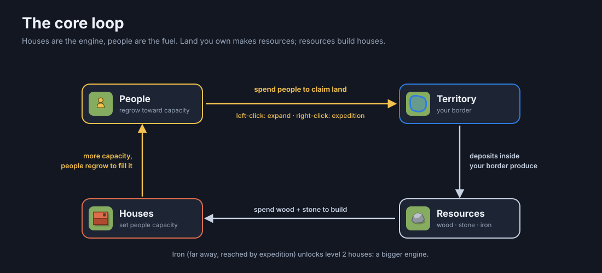

# Map Factory

A Factorio-style growth game played entirely from a **map view**, in the spirit of openfront.io. Your territory is a border line that grows across a seeded **disk world floating in space**. People are the currency: houses set how many you can have, you spend people to claim land, and the land you own produces the resources that build more houses.

**▶ Play it in your browser:** https://yclen.github.io/map-factory/

**Your game autosaves in your browser** every 10 seconds; just open the link again to carry on. Press **N** in game for a fresh map.

Add `?seed=123` to the address to play a specific map (this starts that map, and its autosave replaces your current one), for example https://yclen.github.io/map-factory/?seed=42. Every seed gives a different world, a different Moon, and its own procedurally generated far planet.

## What's in the prototype

- **A generated disk world:** 1000 × 1000 tiles of continents, islands, grassland, desert and snowy mountains, ringed by an ice wall, floating in a starfield.
- **The core loop:** people regrow toward house capacity; click to push your border; deposits inside your territory produce wood, stone and iron; build houses to grow.
- **Countries:** every territory is a named country with its own people and stockpile. Right-click far away to found a new one with an expedition, then link your countries with **rail stations** (they lay their own track) or **ports** (ships sail the route) to move people and cargo between them. Linked countries share their output by population (at least a quarter each way), and the goods physically ride the trains and ships, so far colonies get their share late. Countries merge when their borders touch, and their names grow with them: *the Colony of Gorethus* → *Gorethus Harbor* → *the Free State of Gorethus* → … → *the United States of Gorethus*.
- **Population unlocks:** press **E** for the build menu (grouped by category; put any building on your 10-slot bar with hover + a number key); stations, ports and the housing ladder (House → Apartment → City block, upgraded in place) unlock as your empire grows.
- **AI nations and missiles:** static nations in their own colours share the disk. Push into their land to conquer it and take their houses, or soften them up first with missiles from a missile silo.
- **Collectors:** deposits only produce once something works them: a logger's cabin or miner's camp (each employs 5 people) early on, powered mining rigs later.
- **Energy:** every country has a power budget. Wood burners and solar panels make power; mining rigs and city blocks use it. Power stays inside a territory. Short on power, everything slows down evenly.
- **Copy and paste:** drag a box over houses, press **C** to paste the layout elsewhere.
- **A whole solar system:** the Moon (with phases), the Sun, lava world Vulcan, red planet Aries, gas giants Zeus and Poseidon with their moons, and a **seed world**: a planet generated entirely from the map seed.
- **Zoom from a single house out to the whole solar system**, and click any body to lock the camera onto it.

## Controls

| Input | Action |
|---|---|
| Click near your border | Expand toward that spot (into an AI nation: conquer it) |
| Right-click far away | Send an expedition from the country you're viewing: a truck over land, a boat over water, carrying people and supplies for the new colony |
| E | Build menu (everything, including what's still locked) |
| 1 – 9, 0 | Build whatever is on that slot of your build bar · Esc cancels |
| In the E menu: hover + 1 – 0 | Put that building on that key (right-click a building to add / remove it) |
| F, then click | Fire a missile from your nearest silo in range |
| Apartment or City block, then click a house | Upgrade it in place (cheaper than building fresh) |
| Click inside one of your countries | View that country in the top bar (zoomed out: fly the camera to it) |
| Tab · Shift+Tab | Fly to your next / previous country |
| Drag a box · C | Select houses · paste a copy at the cursor |
| [ / ] | People sent per click (10 / 25 / 50 / 100 %) |
| Scroll · right-drag or WASD | Zoom · pan |
| M | Cycle views: whole disk → Moon orbit → solar system → back |
| Click a body, or L V R Z P G U | Lock onto the Moon, Vulcan, Aries, Zeus, Poseidon, the seed world, the Sun |
| H · N | Jump home · new random map (deletes your save) |

## Repo layout

- [`prototype/`](prototype/): the game (plain HTML, CSS and JavaScript, no build step). All tuning numbers live in the `CFG` block at the top of [`prototype/game.js`](prototype/game.js).
- [`game-idea.md`](game-idea.md): the design document. Start with "How the game works now"; then the design direction, object catalogue, roadmap, and an archive of earlier versions.
- [`art/`](art/): concept art (SVG), generated by [`art/generate_art.py`](art/generate_art.py).

To run it locally, just open `prototype/index.html` in a browser. Add `?bot` to the address to watch a simple AI play (for playtesting).
