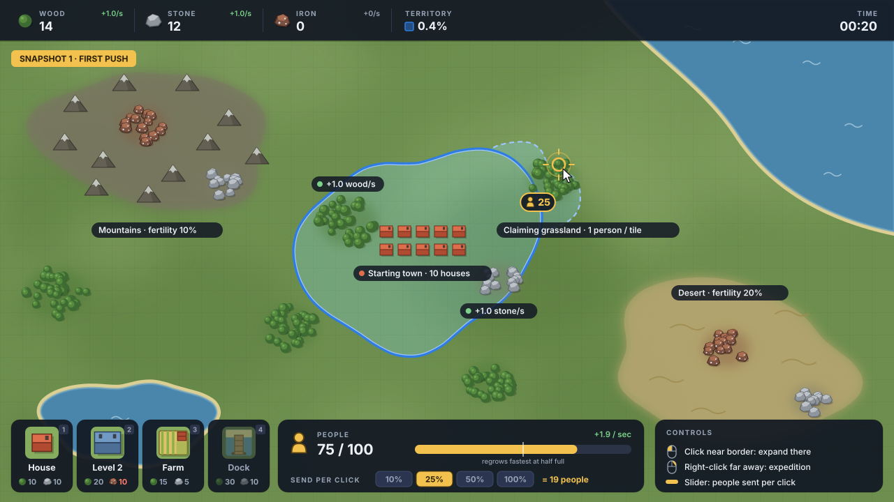

# Map-View Factory Game: Concept

> Working title: TBD

## The pitch

A Factorio-style growth game played entirely from a **map view**, like openfront.io. You own a territory with a border line that grows across the map. You never control individual units or machines. You place **houses, rail stations, and ports**, click to push your border toward the resources you want, and run the whole economy from above.

**People are the currency.** Houses decide how many people you can have. You spend people to claim land, and the land you own produces resources. Resources build more houses.

---

## How the game works now (prototype v10)

The rules as they are in the playable prototype ([`prototype/`](prototype/), or [play it online](https://yclen.github.io/map-factory/)). Everything below is current; older versions are in the Archive at the end. All numbers live in `CFG` at the top of `prototype/game.js` and are placeholders until playtesting.

**The world.** A seeded 1000 × 1000 disk floating in space, ringed by an ice wall: continents, islands, grassland, desert and mountains. Same seed (`?seed=42`), same world. Above it is a whole solar system (the Moon, the Sun, lava world Vulcan, red Aries, gas giants Zeus and Poseidon with their moons, and a seed world generated from the map seed); zoom from one house out to the solar system, and click any body to lock on.

**The start.** A home town of 10 houses (100 people) near the centre of the disk, a logger's cabin and a miner's camp on its home forest and stone (about 1.8 wood and 1.4 stone a second), 50 wood and 50 stone.

**People.** Every country has its own people. They regrow toward its **housing capacity** (an S-curve, fastest at half full) and are spent to expand and to send expeditions. People working a collector can't be sent.

**Expanding.** Click near your border to push it toward that spot with a share of the nearest country's free people (10 / 25 / 50 / 100 %, `[ ]`). Land costs people per tile: grassland 0.5, desert 1.5, mountains 2.5. Pushing into an **AI nation** costs extra (see below).

**Countries.** Every separate piece of your territory is a **country** with its own people, stockpile and power. **Right-click** far away to send an expedition from the **country you're viewing** (the one in the top bar; click a country to select it): a **truck** over land, a **boat** over water (boats leave from your nearest port if you have one). It carries the same share of the country's stockpile as of its people (the send %), and at least 40 wood and 40 stone if home has them: enough for the colony to build a station with track, or a cabin and a camp, straight away. The settlers live there until you build houses. Countries **merge** when their borders touch. **Names grow with housing**: *the Colony of Gorethus* → *Gorethus Harbor / Hold / Oasis / Vale* (50) → *the Free State of Gorethus* (200) → *the Federation of Gorethus* (1,000) → *the United States of Gorethus* (5,000). Click a country from far out (or press Tab) to fly to it.

**Resources: wood, stone, iron.** A deposit produces only when something works it:
- **Logger's cabin** (forest) / **Miner's camp** (stone, iron): employ 5 people each.
- **Mining rig** (500 people): the upgrade of either; 3× output, no workers, uses 4 MW, nothing without power.

**Housing ladder** (upgrade in place: pick the higher level and click the lower one; you pay only the steps in between): **House** 10 → **Apartment** 30 (300 people) → **City block** 80 (1,000 people; uses 3 MW, holds only 30 without power).

**Energy.** Each country has a power budget (top bar: MW used / available). **Wood burner** (400): 8 MW, burns up to 0.25 wood/s, only what's needed. **Solar panel** (700): 1.5 MW per tile, free, used first. Short on power, every user slows down evenly. Power never leaves a territory: no power lines.

**Transport.** **Rail stations** (from the start) lay track to your nearest station (up to 120 tiles; track costs 0.15 wood + 0.15 stone per tile); **ports** (from the start) open a sea route to your nearest port. Linked countries **share their output, not their stockpiles**: each country's new production is split with the countries it's linked to by **population**, and each end gets at least **25%** of the other's output however small it is (a country with several links divides that between them). So a new colony keeps its kit and gets a quarter of home's income; a mining colony sends most of its iron home. The share waits at the station until a train or ship picks it up (30 goods and 12 people a trip by train, 40 and 10 by ship), so long routes deliver slowly and late. The top bar shows each country's income after sharing, and goods on their way in gold. People move too, toward the end with more room in its houses.

**AI nations.** 7 static nations in their own colours, each with houses, collectors and a population that regrows. **Conquest works like openfront:** push into their land; each tile costs 0.5 + 2.5 × (their people per tile) extra and kills defenders, and their buildings become yours. A nation with no land left is conquered.

**Missiles.** A **missile silo** (600) fires short-range missiles: press **F**, click a target within 60 tiles. Each costs 10 wood + 10 iron, reloads in 6 s, and the blast (radius 3) destroys every building and kills 3 people per tile, yours included.

**Unlocks and building.** Buildings unlock by your empire's **peak population**. **E** opens the build menu, grouped by category (Housing, Resources, Energy, Transport, Military). The bottom bar is a **hotbar** on keys 1–9, 0: new unlocks fill empty slots; in the E menu, hover any building and press a number to put it on that key, or right-click to add / remove it. Drag a box over houses and press **C** to paste copies.

**Saving.** The game **autosaves to your browser** every 10 seconds (and when you leave the page). Opening the game without `?seed=` resumes it; **N** starts a new map and deletes the save. Opening a link with a different `?seed=` starts that map, and its autosave replaces the old one. After an update, a save that no longer fits the game (say, a building was renamed) is dropped and a fresh map starts.

Controls are listed in the [README](README.md#controls).

---

## Design direction: decisions and brainstorms

> Status: **mostly brainstorm.** Captures the 2026-11-21 voice brainstorms plus a proposed way to organise them. **Decided so far:** population unlocks the tech tree; the build menu opens with **E**; territories are **countries** with their own people and resources; the end goal is to **fly into the black hole** at the centre of the galaxy. Nothing here is in the prototype yet.

### The big idea: progression is about motion
Players don't progress by stacking abstract upgrades. They progress by **reaching further**: every new technology is a better way to move people and resources across a barrier they couldn't cross before.

**The journey:**
1. Start in the centre of the disk and build up your first city.
2. Get the transport technology to travel: cross land, then oceans.
3. Set up **travel links** between your colonies, because colonies can't share anything without them (see Logistics). This is the reason to keep investing in better transport.
4. Push all the way to the **edge of the world, the ice wall**. That's where space technology starts.
5. Launch a **rocket** into orbit around your world. From orbit, build **fuel stations** and **space stations**.
6. From orbit, launch to the **other planets**.

### Logistics: every territory keeps its own stockpile
A shift from the prototype, where all resources go into one global pool:
- **Each separate territory has its own stockpile.** Resources mined in a colony belong to that colony.
- **Merged territories share one stockpile.** If two territories grow until they touch, they become one.
- **Travel links move resources and people between territories.** Each link has a **throughput** (how much per minute) and a **travel time** (how long a shipment takes), set by the transport technology it uses.
- So better transport means more stuff moving faster, which is the point of upgrading.

### Countries (DECIDED 2026-11-21, in the prototype)
- **Every separate territory is a country,** with its own name, its own **people** and its own **resources**. Your first country is your home; every outpost that survives becomes a new country of yours until it merges with another.
- **People are per country too.** Each country's population regrows toward the capacity of *its own* houses, and its pushes and buildings spend *its own* people.
- **Links move people as well as resources.** A port, rail line or (later) spaceport has a **person transfer rate** (people per minute) alongside its cargo rate.
- **What moving people is for:** a small new colony can't grow fast on its own people. You ship settlers from your big home country to power its expansion and building. Moving people is how you choose *where* your empire grows.
- **Merging:** when two of your countries' borders touch, they become one country and pool their people and resources.
- **Country names:** generated from the seed: a name plus a form, e.g. *the Kingdom of Velmora*, *the Kethar Republic*, *the Free State of Ixos*, *the Union of Oth*. AI nations get names the same way.

### Energy and production (DECIDED 2026-11-21)
**Energy is the central system.** Population unlocks a building; **power lets you run it**. Every ambitious thing (city blocks, mining rigs, launch sites, later the planet lasers) uses power, so each era's goal needs a new, bigger power source. The only technology the game is really *about* is **transportation**, since that's what gets you to space and wins the game. Energy is what pays for it.

**No crafting chains.** Turning ore into bars, wood into planks and so on is cut: it's a delay, not a decision. A conversion step only exists if it creates a new decision about where to build or what to give up (e.g. ice + power → hydrogen at the ice wall, for rockets). At most a few in the whole game.

**No item inventory.** Buildings are paid for straight out of a country's stockpile when you place them, as now. A country's inventory is just its raw resources. (Exception, maybe later: things that move, like rockets.)

**No compute / data centers.** Considered and dropped: it doesn't add much.

**How power works:**
- Each country has a **power budget**: supply (MW) from its plants, demand from its machines. It shows in the top bar like capacity does.
- **Short on power → everything that uses it slows down evenly** (a brownout). No wiring.
- Power stays inside a country (for now; power lines between countries could come later).

**Power sources:**

| Source | Needs | Role | Status |
|---|---|---|---|
| **Wood burner** | burns wood (coal too, if coal deposits are added) | the first power; competes with building for wood | in the prototype |
| **Solar panel** | open land, one tile each | **key**: free power, but every panel takes a tile you can't use for anything else. Cover land with it. | in the prototype |
| **Nuclear plant** | uranium, a **rare deposit** | lots of power; a reason to fight over uranium | later (Era 3) |
| **Geothermal plant** | lava | power from lava (Vulcan, and any lava world) | later (space) |
| **Fusion plant** | helium-3 from gas giants | endgame power | later (Era 5) |

Dropped: wind (there is no wind on the disk), a separate coal plant (coal is just another fuel for the burner), hydro.

**Power users (first set):** mining rigs, city blocks; later launch sites, ice mines, hydrogen plants, telescopes, space stations, lasers.

**Power belongs to a territory (DECIDED).** No power lines and no energy transport: power is made and used inside one connected territory (one country). Links carry people and cargo, never power. To power a colony, build plants there, or grow it until it touches your other land.

**Resources are collector-based (DECIDED, in the prototype).** Owning a deposit gives you nothing until something works it:
- **Early game: people do the work.** A **Logger's cabin** (on a forest) or a **Miner's camp** (on stone or iron) makes the whole deposit produce. Each **employs 5 people**: they still count toward your population, but they **can't be sent** on pushes or expeditions. If the country has fewer people than its jobs, every collector slows down evenly.
- **Later: machines run on power.** A **Mining rig** is the upgrade of a cabin or camp (click it): 3x the output and the workers are freed, but it uses 4 MW, and **no power means no output**.
- One collector per deposit. Your starting town comes with a cabin and a camp on its home forest and stone; colonies have to build their own.

### AI nations and missiles (DECIDED 2026-11-21)
**AI nations, v1: static civilizations.** They spawn at random places on the disk, each in its **own colour**, with a territory, houses, collectors on their deposits, and a population that regrows to fill their houses. They don't expand, build or attack yet; smarter AI comes later.

**Conquest works like openfront:** you take their land by **pushing into it**, the same left-click as expanding. Enemy land costs more people than empty land: the more crowded the nation (people per tile), the harder each tile is to take, and every tile you take kills some of its defenders. **When your border reaches their buildings, you get them**: their houses become your houses, their cabins and camps become yours. A nation with no land left is gone.

**Missiles are the first weapon.** Range is the whole idea, and it leads straight into rockets and space:

| Tier | Reach | Status |
|---|---|---|
| **Short-range missile** | ~60 tiles from a missile silo | in the prototype |
| **Long-range missile** | a few hundred tiles (across a sea) | later |
| **Intercontinental missile** | anywhere on the disk | later; the step before real rockets |
| **Warheads**: nuclear, then hydrogen | much bigger blasts on the same missiles | later |

A missile is fired from a **Missile silo** and costs resources per shot. It flies in an arc, and the blast **destroys buildings** and **kills people** in a small radius, in anyone's territory. Missiles soften a nation before you push in: fewer houses means fewer people, which means cheaper land.

### A methodology for the tech tree
A simple way to organise the whole progression, so it stays coherent as it grows:

**1. Every technology is a transport tier (or something that serves one).** Each tier answers one question: *which barrier does it let you cross, and how fast and how much?*

**2. Every tier is described by the same few properties,** so they can all live in one table (like the `CFG` block in the code):

| Property | What it means |
|---|---|
| Crosses | which terrain it can travel over (land, coast, deep ocean, ice wall, orbit, interplanetary) |
| Speed | how fast people and cargo travel |
| Capacity | how much it carries per trip / per minute |
| Build cost | which resources it costs to build the link |
| Running cost | fuel or upkeep, if any |
| Unlock | what you need before you can build it (see step 3) |

**3. Unlocking (DECIDED 2026-11-21): population unlocks the tech tree. No research points.** You unlock a tier by reaching a population size; some tiers also need their "first" building.
- Each tier needs a **population threshold** (e.g. 500 people across your connected territory) **plus** a one-off construction (e.g. your first *Shipyard*, costing resources).
- **Why this way:** it uses the systems the game already has (people are the currency, resources build things), it's visible on the map (you can see the Shipyard), and it ties growth to reach: you need a bigger empire to unlock the next way of travelling.
- Considered and rejected: research points generated by people (the classic tech tree).

### The build menu (E)
- Press **E** to open a menu of everything you can build.
- **New objects appear in the menu as your population passes their threshold**, so the menu itself shows your progress. Locked objects could show greyed out with the population they need ("unlocks at 500 people"), so players know what's coming.
- ~~Key change needed: E was "send more people"~~ done: send % moved to **[** and **]**.
- **Done (v10):** the menu is grouped by category, and the bottom bar is a 10-slot **hotbar** (keys 1–9, 0) that you fill from the menu, since there will be far too many buildings for one key each.

### Object levels (proposal)
- **Some objects have levels you upgrade in place:** click a built object, pay, and it gets better. Each level is its own population unlock.
- **Worth it for a few core objects, not everything:**
  - **Housing ladder:** hut → house → apartment → **city block**, each holding more people. (In the prototype as House → Apartment → City block.)
  - **Transport links:** e.g. a rail line upgraded to carry more, faster.
- **Why:** keeps the menu short, makes your city visibly grow up, and reuses the population-unlock system.
- **Cities** as the top of the housing ladder, or as a special building that boosts all the houses around it. Open.
- **Copy and paste** (already in the prototype) matters more as cities get bigger: it's how you'd lay out whole districts quickly.

**4. Resources follow the same eras.** Each era adds the resources the next tier needs, and those resources are usually found *beyond* the current barrier, so you must cross it to progress.

### Draft transport tiers (placeholders)

**Direction set 2026-11-21:** cargo physically rides the vehicles (in the prototype, v9), so **speed and capacity per trip** are what each tier improves. Proposed ladder, built as in-place upgrades like housing:

| Tier | Land | Sea | Air |
|---|---|---|---|
| 1 | Trucks: a cheap depot, short land routes, no track | Sailing ship | |
| 2 | Rail (in the prototype) | Steamship: faster, 2× cargo | |
| 3 | Fast rail | Container ship: huge cargo | **Airport**: links any two of your airports, no route needed, very fast, small loads, uses power |
| 4 | | | Rockets (the space era) |

Older draft, kept for reference:

| Tier | Transport | Crosses | Speed / capacity | Unlock idea |
|---|---|---|---|---|
| 0 | Walking (expeditions) | land | slow / small | start |
| 1 | Roads and carts (horses?) | land | faster / small | a few hundred people + wood, stone |
| 2 | Boats | coasts, lakes | medium / medium | first port + people |
| 3 | Rail | land | fast / large | iron |
| 4 | Ocean ships | deep ocean | medium / large | steel? fuel? |
| 5 | Ice-wall launch site | the edge of the world | - | reach the ice wall |
| 6 | Rockets | world → orbit | - / small | fuel + metals |
| 7 | Orbital fuel and space stations | orbit | - | water (ice), metals |
| 8 | Interplanetary ships | orbit → other planets | slow / medium | nuclear fuel |

**Why the ice wall is where space starts (one idea):** the wall is made of ice, and ice → **water** → rocket **fuel** (hydrogen). Its height could also make it the natural launch site. So reaching the edge of the world is the gate to space.

### Resources by era (draft)
- **Disk, early:** wood, stone, iron (what the prototype has now)
- **Disk, industrial:** power; maybe coal as burner fuel (no steel or other processed goods)
- **Space:** **water** (from ice), **minerals and metals**, rocket **fuel**, **nuclear fuel** for energy production
- Open: which resources exist only on other planets (Vulcan's heavy metals and sulfur? Aries? the gas giants?)

### Combat (rough)
- You should be able to fight **other territories**, e.g. AI empires on the same disk.
- Weapons should be fairly advanced and unlock over time.
- Idea to explore: weapons ride on the same transport network. Faster, longer-range transport also means faster, longer-range attacks, so the transport tree doubles as the military tree.

### Items and properties
There will be many items, each with properties to track. Proposal: keep every item and technology as a **row in one data table** (name, era, costs, requirements, speed, capacity, what it crosses), the way the prototype keeps all its numbers in `CFG`. New content then means adding a row, not writing new code.

### Open questions
- How detailed should transport get (horses? carts? or straight to roads)?
- What does combat look like moment to moment?
- Which resources exist only off-world?
- How does the detailed small-scale world connect to large-scale planning (see `notes.md`)?

### Zoom levels: what you see at each scale (direction set 2026-11-21)
- **Up close:** detailed, interesting models of buildings, trees, deposits.
- **Zooming out:** details simply **stop being drawn** once they'd be too small to see.
- **In their place:** an **icon** where there's a city or settlement, and the **country's name** written across its territory on the map.
- The prototype already does most of this (Detail → Region → Map → whole disk: sprites become squares become city icons). **New:** country names on the map, and making the detailed close-up models more interesting.

### The galaxy and exploration (future brainstorm, 2026-11-21)
- **A galaxy of about 1,000 stars,** generated from the seed, with a **black hole at the centre** (the end goal: fly into it).
- **Each star has a procedurally generated solar system** (its planets built by rules like the seed world). The "format" of a solar system still needs designing: how many planets, what kinds, in what order, belts, moons.
- **You can't see everything at once.** The galaxy map has a **resolution limit**: zoom in on any star and it's just a dot. Only your **own Sun** is in high resolution, with its planets visible.
- **Telescopes resolve stars.** Build a telescope, click a star, and it **resolves over time**: you watch it scan in pixel by pixel until its planets appear. Better telescopes could resolve faster, or further away.
- **Or go there.** Travelling to a star reveals it fully.
- This makes **seeing** part of progression too: like transport, telescopes extend your *reach*.
- Rendering should be cheap: 1,000 stars are just dots until you resolve one.

#### Star types (brainstorm 2026-11-21)
Each star type has its own **rules for what kind of solar system it gets**:

| Star | How common | Its solar system |
|---|---|---|
| **Red dwarf** | Most common | Small, dim stars. A few **smallish rocky worlds**, packed close in |
| **Yellow star** | Common | Like our Sun, but with a **shuffled order**: a **big gas giant close in**, then a **big rocky or ocean world**, then a mix of other planets. Only a few rocky worlds |
| **Blue giant** | Rare, found in **nebula clouds** | Huge, wild systems: up to **~30 planets**, widely spread, with the strangest worlds |

**Exotic objects** (rare, for fun and danger):
- **White dwarfs:** the cooling leftover core of a dead star; a few scorched or frozen survivor worlds
- **Neutron stars:** tiny, incredibly dense dead stars
- **Pulsars:** neutron stars sweeping beams of radiation around like a lighthouse
- **Magnetars:** neutron stars with enormous magnetic fields
- **Stellar black holes:** smaller black holes scattered around the galaxy
- **The supermassive black hole** at the centre: the end goal

#### Galaxy regions
The galaxy isn't uniform. Different regions have different mixes of stars:
- **Nebula clouds:** dense, glowing gas regions full of **young blue stars** (rich, wild systems)
- **The open galaxy:** mostly **red dwarfs**, with **yellow stars** mixed in
- **The core** around the black hole: crowded, with old stars and remnants (white dwarfs, neutron stars)
- Open: spiral arms? dead zones? where each exotic object type shows up

#### Planets are resource sources
The main point of exploring: **every planet has resources you can extract**, and its type decides which:

| Planet type | Main resources (draft) |
|---|---|
| Rocky worlds | minerals, metals |
| Lava worlds (like Vulcan) | heavy metals, sulfur |
| Ice worlds and icy moons | **water** |
| Ocean worlds | water |
| Gas giants | hydrogen, **helium-3** (fusion fuel) |
| Exotic remnants (neutron stars etc.) | something rare and late-game (exotic matter?) |

Open: is **hydrogen** its own resource, or just made from water? How do you actually extract resources (outposts on the surface, orbital mining, scoops for gas giants)?

#### Can we generate this many planets? Yes.
- A planet is just a **recipe**: a few dozen numbers rolled from the seed (type, size, colours, resources). 1,000 stars × up to 30 planets ≈ 30,000 recipes, which takes almost no time or memory.
- The expensive part is **painting a planet's surface** (~0.05–0.1 s each with the current code). That only happens **when you actually look at one** (after a telescope resolves it or you travel there), and the result is kept. Only a handful are ever painted at once.
- So the galaxy can be huge and still fast. The seed-world generator is already the first version of this.

---

## Object catalogue (draft v1, 2026-11-21)

> **Draft for review.** Every number is a placeholder; the point is the *shape*: which objects exist, how they group, what unlocks them, and what each era adds. **Unlock** = your empire's peak population. **In game** marks what the prototype already has.

### How the catalogue works
- **One table row per object** (in the code, one entry in `CFG.buildings`). Each row has: name, category, era, unlock population, cost, what it does, and (for some) **levels**.
- **Levels upgrade in place:** pick the higher level from the build menu and click an existing lower one. You pay only the steps in between and keep the spot. Placing a higher level on clear land is allowed but pays the whole ladder, so upgrading is always cheaper.
- **Categories:** Housing · Extraction · Processing · Energy · Transport · Science · Military (military is its own tree, designed with combat).
- **Eras** follow "progression is about reach": each era's buildings let you cross the next barrier, and each era adds the resources the next one needs.

### Era 1: Settlement (start → ~1,000 people)
Resources: **wood, stone, iron**

| Object | Category | Levels | Unlock | Cost (draft) | Does | In game |
|---|---|---|---|---|---|---|
| **House** | Housing | L1 of the housing ladder | 0 | 10 wood, 10 stone | +10 capacity | ✅ |
| **Apartment** | Housing | L2 (upgrade a house) | 300 | 20 wood, 10 iron | +30 capacity | ✅ |
| **City block** | Housing | L3 (upgrade an apartment) | 1,000 | 40 wood, 40 stone, 30 iron | +80 capacity; uses 3 MW (holds only 30 without power) | ✅ |
| **Rail station** | Transport | L1–L3 (faster, more cargo) | 0 | 15 wood, 10 stone + track | links countries by land | ✅ (L1) |
| **Port** | Transport | L1–L2 (bigger ships) | 0 | 20 wood, 10 stone | links countries by sea | ✅ (L1) |
| **Wood burner** | Energy | - | 400 | 10 wood, 20 stone | +8 MW, burns up to 0.25 wood/s | ✅ |
| **Logger's cabin** | Extraction | L1 (people) | 0 | 5 wood, 10 stone | makes a forest produce; employs 5 people | ✅ |
| **Miner's camp** | Extraction | L1 (people) | 0 | 15 wood, 5 stone | makes stone or iron produce; employs 5 people | ✅ |
| **Mining rig** | Extraction | L2 (upgrade a cabin or camp) | 500 | 20 wood, 10 stone, 10 iron | ×3 output, no workers; uses 4 MW, no power = no output | ✅ |
| **Solar panel** | Energy | - | 700 | 10 stone, 5 iron | +1.5 MW, takes one tile | ✅ |
| **Road** | Transport | - | 100 | stone per tile | faster pushes and expeditions over land | |

### Era 2: Industry (~1,000 → ~10,000)
New resources: **coal** (maybe, as burner fuel). No processed goods (crafting chains were cut, see Energy and production).

| Object | Category | Levels | Unlock | Does |
|---|---|---|---|---|
| **Shipyard** | Transport | - | 4,000 | ocean-going ships: cross deep oceans, carry much more |
| **Tower block** | Housing | L4 of the housing ladder | 6,000 | +250 capacity, uses a lot of power |

### Era 3: The edge of the world (~10,000 → ~50,000)
New resources: **water** (ice), **hydrogen**, **uranium**

| Object | Category | Unlock | Does |
|---|---|---|---|
| **Ice mine** | Extraction | 10,000 | mines the ice wall → water |
| **Electrolysis plant** | Processing | 12,000 | water + power → hydrogen (rocket fuel) |
| **Nuclear plant** | Energy | 20,000 | uranium → lots of power |
| **Launch site** | Transport | 25,000 | must sit on the ice wall; builds and launches rockets |
| **Telescope** | Science | 15,000 | resolves stars in the galaxy over time (uses power) |
| **Geothermal plant** | Energy | (space) | power from lava; on Vulcan or any lava world |

### Era 4: Orbit
| Object | Category | Does |
|---|---|---|
| **Rocket** | Transport | world → orbit; carries people and cargo |
| **Space station** | Housing / Transport | lives in orbit; the hub for everything in space |
| **Fuel depot** | Transport | stores hydrogen in orbit so ships can refuel |

### Era 5: The solar system
New resources: **helium-3** (gas giants), **heavy metals, sulfur** (Vulcan), **minerals** (rocky worlds), **water** (icy moons)

| Object | Category | Does |
|---|---|---|
| **Planetary outpost** | Housing | a colony on another world (its own country) |
| **Orbital mine** | Extraction | mines a planet or moon from orbit |
| **Gas scoop** | Extraction | skims helium-3 from a gas giant |
| **Fusion plant** | Energy | helium-3 → huge power |
| **Interplanetary ship** | Transport | travel between planets |

### Era 6: The stars (the endgame)
| Object | Category | Does |
|---|---|---|
| **Deep-space telescope** | Science | resolves distant stars faster |
| **Starship** | Transport | travel between stars |
| **Black-hole probe / final ship** | Transport | the endgame: fly into the black hole at the centre of the galaxy |

### Still to add
- The **military tree** (designed with combat).
- Exact costs, rates and thresholds (tuning, once production chains exist).
- Which buildings have levels beyond housing and transport.

---

## Roadmap

### Design checklist
Everything the design has to work out, and where each stands:

| # | Topic | Direction so far | Status |
|---|---|---|---|
| 1 | **People per country** | Yes: each country has its own people and resources; links carry both (see Countries) | **Decided, in the prototype** |
| 2 | **Object catalogue** | Every building, level and population threshold, kept as rows in one data table | **Draft v1 written**; housing ladder in the prototype |
| 3 | **Production chains** | **No crafting chains**; only a few conversion steps that create real decisions (e.g. ice → hydrogen). Deposits need a **collector**: people early, powered machines later | **Decided, in the prototype** |
| 4 | **Energy** | **The central system.** Per-country power budget, brownouts when short. Wood burner → solar → nuclear → geothermal → fusion. No wind, no compute | **Decided**; burner, solar, mining rig in the prototype |
| 5 | **AI nations and combat** | v1: **static nations** in their own colours; conquer them openfront-style by pushing in (you take their houses). First weapon: **missiles** in range tiers (short → long → intercontinental → nuclear/hydrogen warheads). Later: AI that expands and attacks | **v1 decided, in the prototype** |
| 6 | **Goal** | **Fly into the black hole at the centre of the galaxy.** Eventually a whole galaxy of seeded solar systems; for now, just one system | **Decided** (galaxy later) |
| 7 | **Losing and damage** | Part of combat: losing territory, damaged buildings | To do (with combat) |
| 8 | **Space gameplay** | Where the game should **shine**: visit planets, mine them for resources, a **planetary tech tree** of advanced technology, and big weapons like **planet-slicing lasers** | To do |
| 9 | **Small scale vs large scale** | Detailed models up close; the further out you zoom, the more detail **disappears** and is replaced by **icons** (city, settlement) and **country names** on the map (see Zoom levels below) | **Direction set** |
| 10 | **Pace and saving** | **Autosave** in the browser (v10). Game length and pacing still open | Saving **done**; pacing open |
| 11 | **Multiplayer** | Single-player first; **multiplayer combat eventually** | Direction set |
| 12 | **Tutorial** | A **tutorial mode** to teach new players | **Decided** (build later) |
| 13 | **Galaxy and exploration** | ~**1,000 seeded stars** in regions (nebula clouds of blue stars, open galaxy of red and yellow stars, a crowded core); each **star type** has its own solar-system rules; exotic objects (white dwarfs, neutron stars, pulsars, magnetars, black holes); every planet is a **resource source**; you only see your own system in detail, and **telescopes** resolve other stars over time | Direction set (later) |

**Suggested work order:** each step builds on the one before.
1. ~~The **people-per-country model** in the prototype~~ **done**
2. ~~The **object catalogue**~~ **draft v1 written** (see Object catalogue) and ~~the **E build menu** with population unlocks~~ **done**
3. ~~**Production chains** and **energy**~~ **decided, in the prototype**
4. **AI nations**, then **combat**, losing and damage (**v1 in the prototype**: static nations, conquest, short-range missiles)
   - **Next up:** the **transport ladder** (steamships, airports; see Draft transport tiers), then **AI v2** (nations that expand and fight back)
5. **Space**: rockets, orbit, other planets, the planetary tech tree
6. The **galaxy** (1,000 seeded stars), **telescopes**, and the black hole
7. **Tutorial** once the core is stable; multiplayer last

### Prototype choices to revisit
Things the prototype had to pick that the design hasn't decided:
- **Links balance automatically.** You can't yet choose to send people or cargo one way; vehicles move people toward the emptier country and split goods by population share (v9). Manual control (e.g. "send 50 settlers to Gorethus") may be needed for "choosing where your empire grows".
- **Unlocks use the empire's peak population** (all countries added up, at its highest), so an unlock never disappears when you spend people.
- **Unlock thresholds** (150 to 1,000 people) and most costs are placeholders: needs a real playtest.
- ~~A colony that starves keeps its land~~ (settlers no longer starve; a colony is just a country)

### Smaller things still to decide
- The regrowth curve: keep the S-curve, or a flat rate per house?
- Do deposits run out? More resources and biomes (coal as burner fuel, oil, uranium for nuclear)?
- Day and night for solar (the Sun's position is already real).
- Manual link control ("send 50 settlers to Gorethus").
- Should expeditions *need* a building to launch from (boats only from ports, trucks from a depot)? Today boats prefer a port but don't require one.
- What each world in the solar system is for (resources per planet are sketched in the galaxy brainstorm).
- More seed-world classes (desert, ocean and frozen worlds) and moon types.

---

## Open questions
- **Pacing:** how long should a game take, and how fast should each era arrive? Needs a real playtest.
- **AI v2:** how smart should nations be when they start to expand and attack? (combat checklist row)
- **Transport ladder:** exact speeds, capacities and unlocks for trucks, steamships and airports.
- **Space:** what launching from the ice wall looks like moment to moment.

*Answered since the first draft:* competition (AI nations you can conquer), win condition (fly into the black hole), map (random, seeded), scope (single-player in the browser first, multiplayer later), networks (goods take time to arrive), expedition supplies (no timer; colonies are just countries).

---

## The seed world (procedural planet generator)

Every map seed also generates one extra planet, the **seed world**, orbiting beyond Poseidon at 7.5× your distance from the Sun. It has its own name and moons. **The same seed always gives the same planet;** a new seed gives a new one. In the prototype, press **G** to fly to it; the game tells you what this seed produced when it starts.

**How a number becomes a planet:** the seed is scrambled, then traits are rolled one after another in a fixed order. Because the order never changes, the same seed always rolls the same traits.

**1. Name:** 2–3 random syllables plus an optional ending (e.g. *Pequaon*, *Rahotha*, *Anyrlia*).

**2. Class:** 50% **gas giant**, 50% **rocky world**.

**3a. Gas giant traits**

| Trait | Range |
|---|---|
| Size | 3–7× your world |
| Colour family | any hue (named: crimson, amber, golden, olive, jade, teal, azure, indigo, violet, rose) |
| Cloud bands | 8–18, with turbulence 0.5–1.3 |
| Great storm | 70% chance, dark or bright, random position and size |
| Rings | 45% chance |
| Moons | 1–4 |

**3b. Rocky world traits**

| Trait | Range |
|---|---|
| Size | 0.35–1.4× your world |
| Atmosphere | none (25%), thin (50%), thick (25%), in any colour |
| Liquid | none, water oceans, lava seas, methane seas, or acid lakes, covering 20–65% of the surface |
| Ground colour | any hue, muted to rich |
| Mountains | smooth to jagged |
| Ice caps | 50% chance (never with lava) |
| Craters | many with no air, some with thin air, almost none with thick air (air burns up meteors) |
| Clouds | wispy cloud bands when the atmosphere is thick |
| Moons | 0–2 |

**4. Each moon:** its own name, size, colour tint, a 15% chance to orbit backwards, and one of five types:

| Type | Looks like | Real example |
|---|---|---|
| Icy | pale ice cracked with dark lines | Europa |
| Volcanic | sulfur yellows with black vents, some glowing | Io |
| Hazy | a smooth ball of thick smog with a glowing haze | Titan |
| Cratered | dark ancient crust covered in bright craters | Callisto |
| Frost | streaky frost with a bright polar cap | Triton |

**Examples:** seed 42 → *Pequaon*, a rocky world with a thin rose atmosphere, oceans and ice caps, and two moons. Seed 777 → *Rahotha*, an indigo gas giant with a great storm and three moons. Seed 123 → *Anyrlia*, a rocky world with a thick jade atmosphere and lava seas.

Across 200 seeds the rolls come out about half gas and half rocky; about half the rocky worlds have ice caps.

---

## Tuning (the dials)

Settings to adjust in playtesting. All of them are in `CFG` at the top of `prototype/game.js`:
- **House cost vs. resource rate.** At 1 wood/s, a 1 wood + 1 stone house would mean a new house every second, which is too fast. The mockups use 10 + 10 (about 10 seconds per house at the start). Real costs will likely land around 10–20× the per-second rate.
- **People regrowth rate** (`rate` in the formula)
- **People per tile** for each terrain
- **Expedition travel speed** and kit (`expeditionSpeed`, `expeditionKit`)
- **Station, port, and track costs**, and how much more track costs through mountains and desert
- **How rich** far-away deposits are compared to the ones near the start
- **Unlock thresholds** for every building (`buildings.*.unlock`)
- **Vehicle loads and the shipping reserve** (`vehicles`, `shipReserve`)
- **Power** (`buildings.burner.gen`, `buildings.solar.gen`, `power.burnerWood`, `power.rigMult`)
- **AI nations**: count, size, how hard they defend (`ai.*`)
- **Missiles**: range, cost, blast radius, kills (`buildings.silo.range`, `missile.*`)

---

## Concept art

Drawn for v2 and v3, so some details are out of date (farms, orange outposts). The old gameplay snapshots are in the Archive, under "What it looked like (v2)".

### Item models


| Item | What it does | Cost (placeholder) | Key number (placeholder) |
|---|---|---|---|
| **Person** | The currency. Spent to claim land and to send expeditions. | n/a | Regrows toward capacity |
| **House** | Raises people capacity (only on connected land). | 10 wood · 10 stone | +10 |
| **Level 2 house** | Holds more people. | 20 wood · 10 iron | +30 |
| **Rail station** | Links itself by rail to your nearest station. | 15 wood · 10 stone + track | Track: 0.25 wood + 0.25 stone per tile |
| **Port** | Links itself by sea to your nearest port. | 20 wood · 10 stone | Must be on the coast |
| **Factory** | Turns resources into goods (parked). | TBD | TBD |
| **Drill** | Boosts a deposit's output (parked). | Iron | e.g. ×2 |
| **Territory** | Your land. Deposits inside produce. | People per tile | 1–5 per tile by terrain |
| **Forest** | Wood deposit. | n/a | e.g. 1 wood / sec |
| **Stone deposit** | Stone deposit. | n/a | e.g. 1 stone / sec |
| **Iron deposit** | Iron deposit. Never near the start. | n/a | Unlocks level 2 houses |

### Art direction

These rules keep the mockups (and later the real game) consistent.

- **Camera:** always top-down, always map scale. No close-ups.
- **Shapes:** flat, simple, readable at about 20 px. Each item has one clear silhouette.
- **Palette:**
  - Land green `#86ad5f`, water blue `#4a86ab`, sand shoreline `#dccf93`
  - Player territory: blue `#2f7de1` (20% tint over the land + a solid border line). Land outside your territory is slightly darkened.
  - People: gold `#f2c14e` (the people bar, expedition numbers, anything that's people)
  - UI panels: dark navy `#141a25` / `#1d2433`, light text, green for gains, red for "can't afford" or "dying"
- **Screen layout:**
  - **Top bar:** resources (amount + rate per second), territory %, game time
  - **Bottom left:** build menu: House, Level 2, Station, Port, with number hotkeys 1–4 and costs shown as icons (red = can't afford)
  - **Bottom center:** the people bar (people / capacity, regrowth rate, a mark at half full) and the "send per click" slider (10 / 25 / 50 / 100%)
  - **Bottom right:** a controls reminder (click = expand, right-click = expedition)
  - **On the map:** gold numbers at the border where people are pushing out; dashed areas for land being claimed; a dotted line and marker for expeditions; an orange countdown ring around a new outpost; green "+1.0 wood/s" tags on producing deposits; rail lines (brown sleepers, grey rail) with a red train; dashed white sea routes with a ship
  - **Connected vs. cut off:** connected land is outlined blue; cut-off land is outlined orange *(the prototype dropped this: colonies are blue, orange belongs to AI nations)*
- **Biomes:** desert is sandy tan with dune strokes; mountains are grey-brown with snow-capped peaks

### How the art is made
All the images in `art/` come from one script, [`art/generate_art.py`](art/generate_art.py). The item models, map, and UI are defined once and reused. To change a color, an icon, or a number, edit the script and run:

```
python art/generate_art.py
```

---

## Design history
- **v1:** people were assigned to deposits as workers (0.1/sec each), and drills replaced workers. Food was an open question.
- **v2 (2026-11-20):** deposits inside your border produce on their own. People are spent to claim land and to send expeditions, and regrow toward house capacity. Food is built into land fertility. Drills and factories are parked.
- **Disk world (2026-11-20):** the map became a round disk in outer space, with an ice wall around the rim.
- **v13 (2026-11-21), sharing fixed:** links split each country's **output** by population (at least 25% each way) instead of balancing stockpiles. The stockpile rule never shipped anything while home kept spending its stone on houses (so a linked colony sat at zero), and without the reserve it shipped the colony's own kit home instead.
- **v12 (2026-11-21), faster early game:** deposits produce more (wood and iron 0.1/s per tile, stone 0.12, up from 0.06), you start with 50 wood / 50 stone, stations and ports are available from the start, and track is cheaper (0.15 per tile). A build-houses-only test reached 300 people in about 2 minutes and 400 in about 3.5; stone is still the limit, at twice the old rate.
- **v11 (2026-11-21):** expeditions carry a real kit (the send % of the stockpile, at least 40 wood / 40 stone) so a new colony can build its station right away; expeditions drive as trucks over land and sail as boats over water, leaving from your nearest port. Decided to keep one collector per deposit.
- **v10 (2026-11-21):** cleanup: autosave in the browser; the build bar became a 10-slot hotbar (keys 1–0) and the E menu got categories; expanding no longer rescans the whole map (from ~1.6 ms per tick with 12–48 ms spikes to ~0.06 ms, worst 1 ms); this doc reorganised around "How the game works now".
- **v9 (2026-11-21):** physical shipping: goods and people ride the trains and ships, split by population share; goods on their way shown in the top bar; transport ladder (trucks, steamships, airports) proposed.
- **v8 (2026-11-21):** static AI nations, openfront-style conquest (push in, take their houses), missile silos and short-range missiles.
- **v7 (2026-11-21):** collectors (logger's cabin, miner's camp) worked by people; mining rig as their powered upgrade; power stays inside each territory (no power lines); click or Tab to fly to a country.
- **v6 (2026-11-21):** energy decided as the central system (no crafting chains, no compute, no wind); the prototype gets per-country power, wood burners, solar panels, mining rigs and powered city blocks. Resource collection left open.
- **v5 (2026-11-21), in the prototype:** the object catalogue (draft v1) and the housing ladder: House → Apartment → City block, upgraded in place; keys 1–5.
- **v4 (2026-11-21), in the prototype:** territories became countries with their own people, houses and stockpiles; expeditions found new countries with a supply kit; links move people and cargo between countries; countries merge when they touch; the E build menu with population unlocks (send % moved to [ ]).
- **Progression decisions (2026-11-21):** population unlocks the tech tree; build menu on E; territories are countries with their own people and resources, linked by transport that moves both; the end goal is the black hole at the centre of the galaxy.
- **v3 (2026-11-20):** farms and fertility removed. Territory is either connected to your capital or cut off. Rail stations and ports link themselves to keep outposts alive and bring their resources home.

---

## Inspirations
- **Factorio**: production, growth, scaling up.
- **openfront.io**: map view, a border that expands when you click, people as a number that regrows and gets spent, boats.

---

## Archive: earlier versions

Kept for the record. These sections describe earlier rules (v2 and v3: farms, fertility, cut-off outposts, supply timers) and the prototype's feature notes by version. **The current rules are in "How the game works now".**

### What it looked like (v2 snapshots)

Three mock screenshots of the **same map** at different points in one game. All numbers are placeholders.

> These were drawn for **v2**. Since then (v3), farms and fertility are gone. In snapshot 3 you'd now save the outpost by connecting it with a rail station or port, not by building houses and a farm there. The playable prototype shows the current rules.

#### Snapshot 1: First push


- You start with a small circle of territory, a town of 10 houses (capacity 100), a forest (+1 wood/s), and a stone deposit (+1 stone/s). Production just happens because they're inside your border.
- You left-clicked toward a forest to the north-east with the slider on 25%. **25 people** left the pool: they're the gold number at the border. The dashed area is land being claimed (grassland: 1 person per tile).
- The **people bar** (bottom center) dropped to 75 / 100 and is regrowing at +1.9/sec. The white mark at the halfway point is where regrowth is fastest.
- The map already shows what's out there: **mountains** (fertility 10%) with iron to the north-west, and a **desert** (fertility 20%) with iron to the south-east. The Level 2 house's iron cost is red because you have none yet.

#### Snapshot 2: Expedition


- Your territory has grown and swallowed the north-east forest. Three forests now give +3 wood/s. The town is up to 18 houses (capacity 180).
- You **right-clicked** the desert iron. An **expedition of 40 people** is on its way along the dotted line and arrives in 14 seconds. It's not connected to your territory. It's just a number traveling across the map.
- The people bar is at 98 / 180. Close to half full, so it's refilling fast.

#### Snapshot 3: Outpost


- The expedition landed and planted an **outpost** around the desert iron. Iron is flowing (+1 iron/s), and the outpost already counts as your territory.
- The **orange ring** is the supply countdown: 21 seconds left. The outpost has a farm and 2 houses, so it can house 12 of its 40 people. **28 will starve** unless you build more houses in time.
- You're placing another house there. The tooltip shows it will **hold 6 here**: desert is 20%, plus 40% from the nearby farm. Without the farm, it would hold only 2.
- Meanwhile, a second push of **48 people** is grinding into the mountains to the north-west, at 5 people per tile.
- Once iron builds up, **Level 2 houses** unlock and the whole engine gets bigger.

### Core rules (v2–v3)

#### 0. The world is a disk in space
- The map is a **flat, round disk** floating in outer space, not a rectangle in an endless ocean.
- An **ice wall** rings the edge. Beyond it is darkness and stars.
- It's **big**: many continents, so zoomed out you see a sprawl of land and sea before you see the edge of the disk.
- Players **start near the center**, far from the edge.
- Inside the wall: continents, islands, inner seas, and the biomes. Land thins out toward the wall, so the rim is mostly a ring of sea, with a few coasts reaching the ice.
- **The Moon** orbits the disk at 30× its radius (half the real Earth–Moon distance): a smaller world that turns as it goes, always facing the disk. It has two biomes, **basalt plains** (dark, smooth, the friendly lowlands) and **highlands** (bright, mountainous, heavily cratered), generated from the same seed as the disk.
- **The Sun:** your world circles a big Sun once a "year" (12 minutes). Seen from your world, the Sun circles you; lock onto the Sun to see the truth.
- **Beyond your world:** **Aries**, a Mars-like red planet; then two gas giants, **Zeus** (banded, Great Red Storm, moons Hephaestus, Athena, Hermes) and **Poseidon** (blue, ringed, moons Amphitrite and Triton).
- **Vulcan:** a smaller lava-hellscape planet circles the Sun inside your orbit: lava seas, volcanoes, sulfur flats, heavy-metal ridges, ash wastes, obsidian plains. A future place to mine heavy metals and sulfur?
- **Later idea:** the ice wall and space are where a future "space" stage could happen: climbing the wall, launching off the disk, **settling the Moon**, other disks.

#### 1. Territory
- Your territory is an area with a **border line** around it. You start with a small circle.
- Everything you own and build is inside that line. Land outside it is dimmed.
- Territory does two things for you: any **resource deposit** inside it produces for you, and it gives you **room to build**.

#### 2. People and capacity
- **Capacity comes only from houses.** Each house adds a set amount (e.g. 10).
- Your **people** count regrows by itself toward capacity, and you spend people to grow.
- A **people bar at the bottom of the screen** shows people / capacity (like openfront's troop bar).
- You start with a few houses already built (e.g. 10 houses = 100 capacity, 100 people).

#### 3. Resources come from land you own
- No workers and no assigning people to jobs. **If a deposit is inside your border, it produces automatically.**
- Example: a forest inside your territory gives **1 wood / sec**. A stone deposit gives **1 stone / sec**.
- Resources pile up in a stockpile you spend from.
- Suggestion: each deposit is made of several tiles, and each tile you own adds to the rate. Pushing your border halfway over a forest gives half its output, so the border creeping over a deposit matters.

#### 4. Houses
- Built inside your territory with resources, e.g. **10 wood + 10 stone**. That's your "1 wood + 1 stone" idea scaled up so you can't build one every second; see Tuning.
- Every house raises capacity, which is the only way to have more people.
- **Level 2 house:** needs **iron** and holds more people (e.g. 30). Iron is never near the start, so getting it is your first big goal.

#### 5. Expanding: left-click
- **Left-click** anywhere near your border. A chunk of your people heads toward that spot, and the border grows in that direction.
- The chunk shows as **one number** at the edge of your territory. As it claims land, the number counts down. When it hits 0, the push stops.
- An **expedition-size slider** (e.g. 10% / 25% / 50%) sets how many people each click sends. Click again to send more.
- Land costs people per tile, and harder terrain costs more (see the next section).

#### 6. Expeditions: right-click
- **Right-click** anywhere on the map that's away from your border, like that iron deposit across the map. A group of people (set by the same slider) leaves and travels there. This takes time based on distance.
- They arrive and plant a small circle of territory: an **outpost**.
- A new outpost is **cut off**: it has **supplies for a short time** (a countdown ring), and its resources can't reach your stockpile.
- Before supplies run out, **connect it**: build a rail station there (it links by rail to your nearest station) or a port (it links by sea to your nearest port). Pushing your main border until it touches the outpost works too.
- Connected → its settlers join your people and its resources flow home. Not connected in time → **all the settlers starve**. The land stays yours but cut off, and you can still connect it later.
- Across water, an expedition travels **by boat** automatically. To keep an island outpost alive, connect it with ports.

### How people connect to territory (v2)

**Houses are the engine. People are the fuel.**

1. **Houses set the cap.** Capacity = total of all your houses.
2. **People regrow toward the cap.** Regrowth is slow when you have very few people, fastest around half full, and slow again near full (an S-curve).
3. **Expanding spends people for good.** Each tile you claim uses up people. They settle the land and don't come back to the pool.
4. **But the pool refills.** Your houses are still there, so your people regrow.

**What this does:**
- **How fast you expand depends on how many people you have.** Bigger capacity → bigger pushes and faster regrowth → faster expansion. This is the link you were looking for.
- **Sitting at full capacity wastes growth.** At 100/100 you gain nothing. Spend 50 and you regrow at top speed. So the game keeps nudging you to keep spending, which feels like momentum, not a chore.
- **It's never instant.** A big push empties your pool, and you have to wait for it to refill. That wait is the cost.
- **Every click is one decision:** spend people now to grab land, or wait and spend bigger later.

**Land cost by terrain** (people per tile, placeholder):

| Terrain | People per tile | Feel |
|---|---|---|
| Grassland | 1 | Fast and cheap |
| Forest | 2 | Slower |
| Desert | 3 | Slow |
| Mountains | 5 | Very slow |
| Water | can't expand | Needs a boat expedition |

**For the build manual:** a simple regrowth rule is

```
growth per second = rate × people × (1 − people / capacity) + small base
```

The `small base` keeps you from getting stuck at 0. `rate` is the main speed setting (e.g. 0.03).

#### A walk-through (placeholder numbers)
1. You start with 10 houses → capacity 100, people 100. Your circle covers a forest (+1 wood/s) and a stone deposit (+1 stone/s).
2. You're full, so you build houses. Each one costs 10 wood + 10 stone (about 10 seconds of production). Capacity climbs, and people regrow to fill it.
3. You see **iron** on the far side of a hill. You set the slider to 25% and left-click toward it. 25 people leave the pool, and the border creeps forward across 25 grassland tiles.
4. The pool is at 75/120 now, so it regrows quickly. You click again, and again.
5. The iron is too far to reach that way, so you **right-click** it. 40 people walk out, arrive, and plant an outpost. The countdown starts. You build a station there, and it lays track back to the station in your town. The outpost connects, the 40 settlers join your people, and the iron starts flowing home.
6. With iron coming in, you unlock **level 2 houses** (30 capacity each). Your engine gets much bigger.

### The core loop (v2)


**Houses → people → territory → resources → houses.** Each trip around the loop is bigger than the last.

### Connections: rail and ports (v3)

**Why:** farms only changed a hidden multiplier (house capacity × fertility). They were hard to see and rarely needed, since you could just build houses on grassland. Transport links do the job better and are visible on the map.

**The rule:** every patch of your territory is either **connected** or **cut off**.
- **Connected:** touches your main territory by land, or is linked by **rail** or **sea**.
- **Cut off:** a fresh outpost from an expedition. It has a supply countdown, and its resources **can't reach your main stockpile**.
- Connect it before supplies run out → settlers join your people, its resources flow home, and it needs no houses or food of its own. Fail → the settlers starve.

**New buildings:**
- **Rail station:** stations on the same landmass **link themselves** along the cheapest land route (you never draw track). Track through mountains costs more. Trains run back and forth.
- **Port:** on a coast. Links to your other ports by sea automatically. Ships run between them.
- **Expeditions stay:** a right-click is the one-way trip that starts a settlement; a station or port is the permanent link.

**What went away:** farms and fertility. Houses hold 10 everywhere. Biomes still matter: what it costs to claim land, where iron appears, and what track costs.

**Prototype numbers (placeholders):**

| | Cost | Notes |
|---|---|---|
| Rail station | 15 wood · 10 stone + track | Links to the nearest station on the same landmass |
| Track | 0.25 wood + 0.25 stone per tile | Desert tiles count 1.5×, mountain tiles 3×; max ~120 tiles per link |
| Port | 20 wood · 10 stone | Must be on the coast; links to the nearest port by sea |
| Outpost supplies | ~~45 seconds~~ removed in v8 | ~~Connect it in time or all settlers starve~~ |

- A station or port with nothing to link to yet is still built. The next one you build links to it.
- Each new station or port links to **one** other (the nearest), so your network grows as a chain or tree.

### Later systems (parked in v2; since superseded)

These came up earlier. They don't fit cleanly with the current rules yet, so they're parked until the core works.

#### Factories (superseded 2026-11-21: no crafting chains, see Energy and production)
- Turn raw resources into **goods** that unlock better buildings. This is the "Factorio" part.
- Example chains: wood → planks → better houses; iron → parts → drills, more factories.
- Open: now that people don't work deposits, do factories need people? That could be a second use for people besides expanding.

#### Drills (reworked; became the **mining rig**, in the prototype)
- Since deposits now produce automatically, drills can't "replace workers" anymore.
- New role: build a drill on a deposit to **boost its output** (e.g. ×2). Costs iron, so it's another reason to go get iron.

### Prototype feature notes, v1–v9

A browser prototype of the core loop is in [`prototype/`](prototype/). To play, double-click `prototype/index.html`. It runs in any browser, with no install.

**What's in it:**
- A **randomly generated disk world**, 1000 × 1000 tiles: a round map floating in outer space, ringed by an **ice wall**. It's big enough that zooming out first shows you a spread of **many continents**, and only further out the whole disk. You always **spawn near the center**. Inside are continents, islands, lakes, and the three biomes (green grassland, tan desert, grey-white mountains) plus ocean. Beyond the wall is a starfield with faint nebulae and a soft glow around the rim. The ice wall and space can't be claimed, built on, or crossed by rail or sea routes. Add `?seed=123` to the address to replay a map; press **N** for a new one.
- **Zoom levels**, all with the scroll wheel, from one town out to the whole disk:
  - **Detail** (zoomed in): trees, rocks, ore, and every house drawn as a sprite; the border is a thin line
  - **Region** (middle): buildings as colored squares
  - **Map** (zoomed out): just the terrain, your territory with a chunky pixel border, city icons with house counts, and dots for stone and iron
  - **Whole disk** (press **M**): the full round world in space; markers hide so you just see the continents
  - **Orbit** (press **M** again, or keep scrolling out): the disk and **the Moon** circling it
  - **Solar system** (press **M** a third time): the whole system centred on the Sun, every planet on its dashed orbit ring. Press M once more to jump back.
- **The Moon:** a smaller world, generated from the **same seed** as the disk (same seed = same disk and same Moon). It has two biomes: dark, smooth **basalt plains** (the friendly lowlands; like the real maria, they fill a few giant round impact basins and only have small craters) and bright, rugged **highlands** (crowded with overlapping craters, the big ones with central peaks), plus a few young craters throwing bright rays. It's built as a height map and lit from one side, so mountains, crater walls, and rims get real light and shadow. Hovering it tells you which biome you're over. It orbits the disk at **30× its radius** (half the real Earth–Moon distance, which is about 60 Earth radii), once every **4 minutes**. Its size is true to life too: about a quarter of the disk across, like the real Moon next to Earth. From orbit view your world is a small marble and the Moon a glowing speck, both labeled. It's tidally locked, so it turns as it goes and always shows the disk the same face, and it's lit from one side with a soft shadow on the other. A faint dashed line shows its orbit. Hovering it says "can't reach it yet": it's just to look at for now.
- **Lock onto the Moon:** **click** it, or press **L** from anywhere. Hovering it shows a gold ring and "Click to lock on", and the click target is generous, so even the tiny dot from orbit view is easy to hit. The camera then switches into the **Moon's reference frame**. It moves *and turns* with the Moon, so:
  - the Moon holds perfectly still on screen (no drifting, no spinning)
  - the stars hold still behind it
  - your world hangs in one fixed spot in the Moon's sky (real tidal locking, seen from the Moon)

  The view zooms in so the Moon fills the screen, and the top bar says **Moon**. Zooming and panning move you around the Moon's surface. Press **L** or **Esc** (or **M**, **H**, or double-click elsewhere) to let go.
- **The Sun:** a big glowing star, **12× the disk's radius**, sitting **24× the Earth–Moon distance** away, about 360,000 tiles (the real Sun is ~109× Earth's size and ~390× the Moon's distance; scaled down so it fits). It has a boiling, granulated surface, sunspots, a deep orange edge, and a corona glow, and it slowly spins. Your world circles it once every **12 minutes** (one "year"). The game stays centred on your world, so normally the Sun appears to circle *you*, just like from Earth.
- **Lock onto the Sun:** **click** it or press **U**. The camera switches into the Sun's frame and zooms out to show the whole orbit, so you watch **your world (with its Moon) travel around the Sun**. Press **U** or **Esc** to let go.
- **Lock onto your world:** every body works the same way. From far out (orbit or solar view), or while locked onto the Moon or Sun, hovering your world shows the gold ring and clicking it brings the camera back to your world's frame, showing the whole disk. Up close, clicking your land still pushes your border as usual.
- **Vulcan:** a lava-hellscape planet orbiting the Sun **inside** your world's orbit (45% of your distance), **70% of your world's size**. Being closer to the Sun, it goes round faster (about every 3½ minutes), and it spins on its own axis. Generated from the same seed, with six biomes:
  - **Lava seas:** dark crust plates split by glowing cracks, with open orange-red melt where it's deepest
  - **Volcanoes:** dark basalt cones with glowing calderas and lava flows winding down their slopes
  - **Sulfur flats:** yellows and oranges around the vents, greenish right by them, with crystal specks
  - **Heavy-metal ridges:** rust-red rock with metallic glints
  - **Ash wastes:** grey-brown dust plains
  - **Obsidian plains:** black glassy rock with glowing fissures

  The lava has its own light layer, so it keeps glowing on Vulcan's night side. Hover it to see the biome under your cursor; **click it or press V** to lock on (it holds still, like the Moon).
- **The outer planets** (beyond your world), each with its own seeded surface, sunlight from the real Sun, and hover info:
  - **Aries** (press **R**): the red planet, about half your world's size, at 1.5× your distance from the Sun. Rusty dust plains, dark basalt regions, white polar ice caps, a giant shield volcano, a huge canyon rift, and cratered highlands.
  - **Zeus** (press **Z**): a gas giant 5× your world's size, at 3.2× your distance. Cream, tan and rust cloud belts with turbulence, white ovals, and a **Great Red Storm**. Three moons:
    - **Hephaestus:** sulfur-yellow volcanic moon with black vents ringed in red, some glowing (like Io)
    - **Athena:** bright ice crisscrossed with brown cracks and jumbled "chaos" terrain (like Europa)
    - **Hermes:** dark, ancient crust peppered with bright craters and a giant ringed impact basin (like Callisto)
  - **Poseidon** (press **P**): a deep blue-teal gas giant 3.8× your world's size, at 5× your distance, with a dark storm and **rings** made of fine ringlets with gaps (its shadow falls across them). Two moons:
    - **Amphitrite:** blue-white ice plates over a frozen ocean, split by dark cracks
    - **Triton:** pinkish nitrogen ice with cantaloupe ridges, a bright polar cap with dark geyser streaks, and it **orbits backwards**, like the real Triton
  - Lock-on keys now also include **G** for the seed world.
  - Years follow Kepler's law, so farther planets are slower: Aries ~22 min, Zeus ~69 min, Poseidon ~2¼ hours. Moons are tidally locked to their planets.
  - **Lock-on works on every body:** click it, or use its key (**L** Moon, **V** Vulcan, **R** Aries, **Z** Zeus, **P** Poseidon, **U** Sun). Rocky worlds and moons hold perfectly still (the camera turns with them); locking onto a gas giant zooms out to show its whole family of moons orbiting it.
- **The seed world** (press **G**): a planet generated entirely from the map seed, beyond Poseidon. See "The seed world" section for the rules.
- **Moon phases:** the Moon is lit from the Sun's real direction, so as it orbits your world its lit side swings round: real phases.
- **The full core loop:** people regrow toward house capacity; **click** to push your border (a gold number counts down as land is claimed); deposits inside connected territory produce; build **House / Apartment / City block / Station / Port** with keys 1–5; **right-click** sends an expedition, which turns into a boat over water.
- **Connections:** a new outpost is **cut off** (outlined in orange, with a 45-second supply ring). Build a **station** there and it links itself by rail to your nearest station, with a train running on it. Or build a **port** on the coast and it links by sea to your nearest port, with a ship sailing the route. Once it's connected, the outpost turns blue, its settlers join your people, and its resources count. If you don't connect it in time, the settlers starve.
- **Countries (v4):** every separate territory is a named **country** with its **own people, houses and stockpile**. The top bar shows the country you're viewing (click inside any of your countries to view it).
  - **Pushes and expeditions** use the people of the country nearest the spot you click.
  - **An expedition founds a new country:** it carries a supply kit (20 wood, 20 stone, if home can spare it). The settlers simply live there: build houses with the colony's own stockpile so they can grow, or link it home. *(Until v8 there was a 45-second timer before unhoused settlers starved; it was removed.)*
  - **Links between your countries** (rail or sea) carry **people** toward the emptier country (an overcrowded colony evacuates home; a growing colony gets settlers) and **goods split by population share**. *(Since v9 the goods physically ride the trains and ships; see below.)*
  - **Countries merge** when their borders touch, pooling people and resources.
  - **Names** are generated from the seed and written across each country on the map when you zoom out. **Titles grow with the country** (v8), by its housing capacity, and fit its land:

    | Housing | Title | Example |
    |---|---|---|
    | under 50 | colony | *the Colony of Gorethus* |
    | 50+ | town, by geography: coast (or a port) → *Harbor / Port*, mostly mountains → *Hold / Peaks*, mostly desert → *Oasis / Sands*, else *Town / Crossing / Vale* | *Gorethus Harbor* |
    | 200+ | nation: *Free State, Republic, Kingdom, Duchy* (coastal: also *Maritime Republic*) | *the Free State of Gorethus* |
    | 1,000+ | *Federation, Commonwealth, Dominion, Union* | *the Federation of Gorethus* |
    | 5,000+ | *United States, Empire, Grand Union* | *the United States of Gorethus* |

    The choice within a tier is seeded, so a country keeps its name; a title never shrinks back if houses are lost. Growing a tier shows a toast ("Gorethus Vale is now the Free State of Gorethus!").
- **Build menu (E) and population unlocks:** press **E** for every building, with a description, its cost, and what's still locked. New buildings unlock as your empire's peak population grows: House from the start, **Station at 150**, **Port at 200**, **Apartment at 300**, **City block at 1,000**. The bottom bar shows only what you've unlocked. Send % moved to **[ ]**.
- **Physical shipping (v9):** goods and people **ride the trains and ships**. Each vehicle unloads at a stop, then loads for the other end: the goods above that country's **population share** of the two stockpiles (a country with 20% of the people on a link aims for 20% of the iron), plus people if it's fuller than the other end relative to its houses. **Every country keeps a reserve of 50 of each resource** that never gets shipped away, so a new colony keeps its starting kit while the bigger country sends it a share; settlers in a colony with no houses yet **stay put** (they aren't shipped home). A train carries 30 goods and 12 people a trip, a ship 40 and 10. So a far colony's stockpile rises in steps, late, as each load arrives: long routes are slow, which is the reason to want faster transport. The top bar shows goods on their way in gold (*34 +27*), the people panel shows settlers arriving, and a loaded vehicle shows what it carries (*27 iron*). Loads under 5 of a resource aren't worth a trip.
- **Colonies are just countries (v8):** a new colony is blue like the rest of your empire, with **no supply timer**: its settlers simply live there until you build houses (they only grow into houses that exist). Orange is now an enemy colour.
- **Names grow (v8):** *the Colony of Gorethus* → *Gorethus Vale / Harbor / Hold / Oasis* (50 housing) → *the Free State of Gorethus* (200) → *Federation…* (1,000) → *the United States of Gorethus* (5,000). See Countries.
- **AI nations (v8):** 7 static nations spawn across the disk (seeded), each in its own colour with a name (*the Empire of Yrlia*), a ring of houses, cabins and camps on its deposits, and a population that regrows to fill its houses. Their city icons on the map have rings in their colour. **Click into their land to conquer it**: each tile costs your push extra people (0.5 + 2.5 × their people per tile) and kills some defenders; tiles with buildings hand you the buildings. A nation with no land left is conquered. Hovering their land shows their people and the cost per tile. (Test: 600 people took 118 of Yrlia's 155 tiles and its houses, raising the colony's capacity from 0 to 170.)
- **Missiles (v8):** a **Missile silo** (Q, unlocks at 600 people) fires **short-range missiles**: press **F**, then click a target within 60 tiles (range circles show while aiming). Each shot costs 10 wood and 10 iron, reloads in 6 s, flies in an arc, and the blast (radius 3) destroys every building and kills 3 people per tile, including your own if you aim badly.
- **Collectors (v7):** deposits only produce once something works them. **Logger's cabin** (key 9, on a forest) and **Miner's camp** (key 0, on stone or iron) each employ 5 people, who can't be sent; too few people and they slow down. The people panel shows how many are at work. The start town comes with both. The **Mining rig** is now the powered upgrade of either one (3x, frees the workers, no power = no output).
- **Country select (v7):** zoomed out, **click one of your countries** to fly the camera to it and view its people, stockpile and power; **Tab** / **Shift+Tab** cycles through your countries; clicking the country name in the top bar flies back to it.
- **Energy (v6):** each country has a **power budget**, shown in the top bar (MW used / MW available). **Wood burner** (400 people): 8 MW, burns up to 0.25 wood/s, only as much as needed. **Solar panel** (700): 1.5 MW per tile, free; solar is used first, so panels save wood. **Mining rig** (500): built on a deposit, triples it while powered, uses 4 MW, one per deposit. **City blocks** use 3 MW; without power they hold 30 instead of 80. Short on power, every user slows down evenly. Keys 6–8.
- **Housing ladder (v5):** House (10) → **Apartment** (30) → **City block** (80). Pick a higher level and **click one of your houses to upgrade it in place**: you pay only the steps in between (House → Apartment costs 20 wood, 10 iron). Placing it on clear land works too but pays the whole ladder. Skipping a level (House → City block) pays both steps. Copy-paste copies the levels and upgrades whatever lower housing it lands on. City icons on the map show a country's densest housing.
- **Copy and paste houses:** hold left click and drag a box over houses to select them (gold outlines). A ghost copy follows the mouse, with green tiles where it fits and red where it doesn't. Press **C** to paste it there. It only builds on your own clear land, skips blocked tiles, and stops if you run out of resources. Press C again for more copies; Esc or a click clears the selection. Stations and ports aren't copied. Because of this, **panning is right-drag** (or WASD).
- **Previews:** with the Station or Port tool selected, hovering shows the route it would build (green dashed line), its length, and the total cost including track. Hover any tile to see its biome, cost per tile, and whether it's yours and connected.

**Tuning:** every number is in the `CFG` block at the top of [`prototype/game.js`](prototype/game.js). A few differ from the doc so it feels OK to play: land costs **0.5 / 1.5 / 2.5** people per tile (grass / desert / mountains), and you start with 30 wood + 30 stone.

**Not in yet:** factories, drills, AI or other players, saving, and a win condition.

### Old next-steps checklist (replaced by the Roadmap)
- [x] Core loop: houses → people → territory → resources → houses
- [x] Link people to expansion: spend people per tile, regrow toward house capacity
- [x] Expeditions: right-click, outpost, supply countdown
- [x] v3: connections (rail stations, ports) replace farms; built into the prototype
- [ ] Decide the regrowth curve (S-curve vs. flat)
- [ ] Decide whether outposts pay for their station/port from the main stockpile or from carried resources
- [ ] Pick biomes and which resources show up in each
- [x] Redraw the snapshots for the v2 rules: people bar, border push numbers, expedition in flight, outpost countdown, biomes
- [x] Build a browser prototype of the core loop with a generated map and three zoom levels (`prototype/`)
- [ ] Play it and tune the numbers in `CFG` (regrowth, cost per tile, supply timer, house cost)
- [ ] Prototype next: AI neighbors to compete with, a win condition
- [ ] Decide what the ice wall and outer space are for (a late-game "space" stage?)
- [ ] Decide what the Moon is for: a place to settle? rare resources? something launched from the disk to reach it?
- [ ] Decide what Vulcan is for: heavy metals and sulfur for late-game buildings?
- [ ] Decide what the outer planets and their moons are for (a late-game space-travel layer?)
- [x] Unlock system: population unlocks the tech tree; build menu on **E**
- [x] People are per country, like resources; countries get generated names
- [x] End goal: fly into the black hole at the centre of the galaxy
- [ ] Write the object catalogue: buildings, levels, population thresholds
- [ ] Turn the rest of the Progression brainstorm into decisions: transport tiers, per-territory stockpiles, resources by era, combat
- [ ] Extend the seed-world rules: more planet classes (desert worlds, ocean worlds, frozen worlds), more moon types, or several seed worlds per system
- [ ] Redraw the concept snapshots for v3 (no farm; a station linking the outpost)
