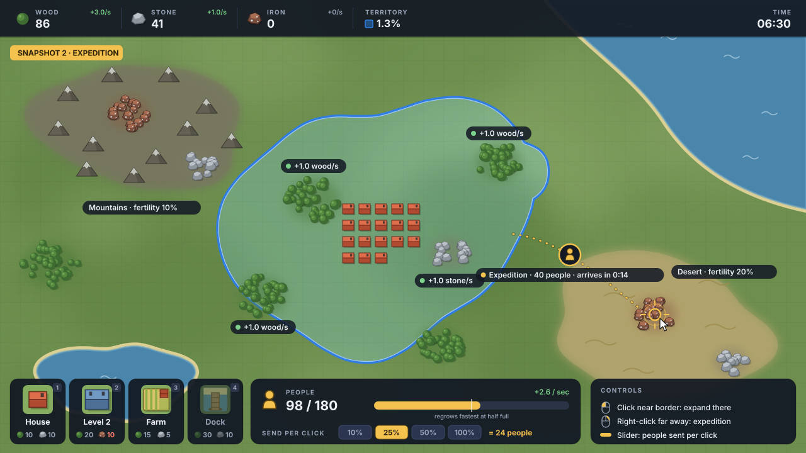
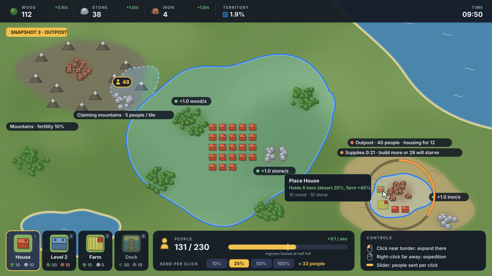
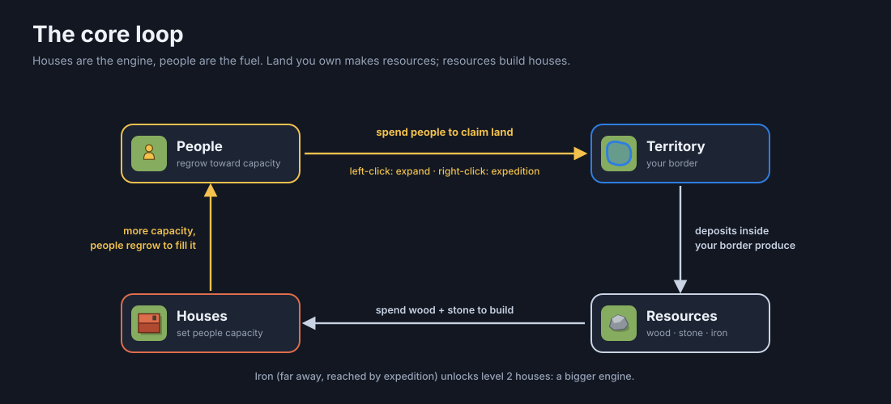
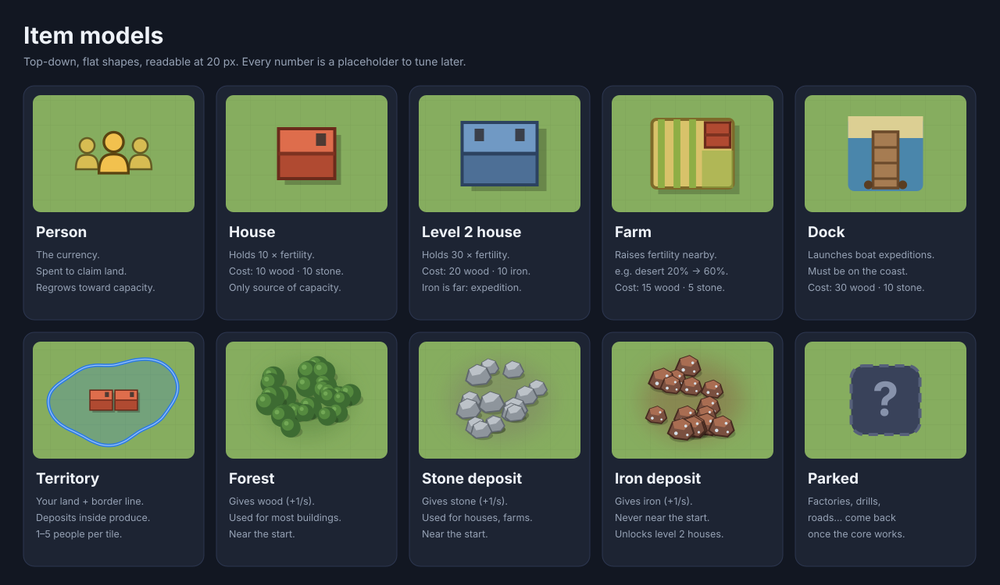

# Map-View Factory Game: Concept

> Working title: TBD

## The pitch

A Factorio-style growth game played entirely from a **map view**, like openfront.io. You own a territory with a border line that grows across the map. You never control individual units or machines. You place **houses, rail stations, and ports**, click to push your border toward the resources you want, and run the whole economy from above.

**People are the currency.** Houses decide how many people you can have. You spend people to claim land, and the land you own produces resources. Resources build more houses.

---

## What it looks like

Three mock screenshots of the **same map** at different points in one game. All numbers are placeholders.

> These were drawn for **v2**. Since then (v3), farms and fertility are gone. In snapshot 3 you'd now save the outpost by connecting it with a rail station or port, not by building houses and a farm there. The playable prototype shows the current rules.

### Snapshot 1: First push


- You start with a small circle of territory, a town of 10 houses (capacity 100), a forest (+1 wood/s), and a stone deposit (+1 stone/s). Production just happens because they're inside your border.
- You left-clicked toward a forest to the north-east with the slider on 25%. **25 people** left the pool: they're the gold number at the border. The dashed area is land being claimed (grassland: 1 person per tile).
- The **people bar** (bottom center) dropped to 75 / 100 and is regrowing at +1.9/sec. The white mark at the halfway point is where regrowth is fastest.
- The map already shows what's out there: **mountains** (fertility 10%) with iron to the north-west, and a **desert** (fertility 20%) with iron to the south-east. The Level 2 house's iron cost is red because you have none yet.

### Snapshot 2: Expedition


- Your territory has grown and swallowed the north-east forest. Three forests now give +3 wood/s. The town is up to 18 houses (capacity 180).
- You **right-clicked** the desert iron. An **expedition of 40 people** is on its way along the dotted line and arrives in 14 seconds. It's not connected to your territory. It's just a number traveling across the map.
- The people bar is at 98 / 180. Close to half full, so it's refilling fast.

### Snapshot 3: Outpost


- The expedition landed and planted an **outpost** around the desert iron. Iron is flowing (+1 iron/s), and the outpost already counts as your territory.
- The **orange ring** is the supply countdown: 21 seconds left. The outpost has a farm and 2 houses, so it can house 12 of its 40 people. **28 will starve** unless you build more houses in time.
- You're placing another house there. The tooltip shows it will **hold 6 here**: desert is 20%, plus 40% from the nearby farm. Without the farm, it would hold only 2.
- Meanwhile, a second push of **48 people** is grinding into the mountains to the north-west, at 5 people per tile.
- Once iron builds up, **Level 2 houses** unlock and the whole engine gets bigger.

---

## Playable prototype

A browser prototype of the core loop is in [`prototype/`](prototype/). To play, double-click `prototype/index.html`. It runs in any browser, with no install.

**What's in it:**
- A **randomly generated disk world**, 1000 × 1000 tiles: a round map floating in outer space, ringed by an **ice wall**. It's big enough that zooming out first shows you a spread of **many continents**, and only further out the whole disk. You always **spawn near the center**. Inside are continents, islands, lakes, and the three biomes (green grassland, tan desert, grey-white mountains) plus ocean. Beyond the wall is a starfield with faint nebulae and a soft glow around the rim. The ice wall and space can't be claimed, built on, or crossed by rail or sea routes. Add `?seed=123` to the address to replay a map; press **N** for a new one.
- **Zoom levels**, all with the scroll wheel, from one town out to the whole disk:
  - **Detail** (zoomed in): trees, rocks, ore, and every house drawn as a sprite; the border is a thin line
  - **Region** (middle): buildings as colored squares
  - **Map** (zoomed out): just the terrain, your territory with a chunky pixel border, city icons with house counts, and dots for stone and iron
  - **Whole disk** (press **M**): the full round world in space; markers hide so you just see the continents
  - **Orbit** (press **M** again, or keep scrolling out): the disk and **the Moon** circling it
  - **Solar system** (press **M** a third time): the whole system centred on the Sun, every planet on its dashed orbit ring. Press M once more to jump back.
- **The Moon:** a smaller world, generated from the **same seed** as the disk (same seed = same disk and same Moon). It has two biomes: dark, smooth **basalt plains** (the friendly lowlands; like the real maria, they fill a few giant round impact basins and only have small craters) and bright, rugged **highlands** (crowded with overlapping craters, the big ones with central peaks), plus a few young craters throwing bright rays. It's built as a height map and lit from one side, so mountains, crater walls, and rims get real light and shadow. Hovering it tells you which biome you're over. It orbits the disk at **30× its radius** (half the real Earth–Moon distance, which is about 60 Earth radii), once every **4 minutes**. Its size is true to life too: about a quarter of the disk across, like the real Moon next to Earth. From orbit view your world is a small marble and the Moon a glowing speck, both labeled. It's tidally locked, so it turns as it goes and always shows the disk the same face, and it's lit from one side with a soft shadow on the other. A faint dashed line shows its orbit. Hovering it says "can't reach it yet": it's just to look at for now.
- **Lock onto the Moon:** **click** it, or press **L** from anywhere. Hovering it shows a gold ring and "Click to lock on", and the click target is generous, so even the tiny dot from orbit view is easy to hit. The camera then switches into the **Moon's reference frame**. It moves *and turns* with the Moon, so:
  - the Moon holds perfectly still on screen (no drifting, no spinning)
  - the stars hold still behind it
  - your world hangs in one fixed spot in the Moon's sky (real tidal locking, seen from the Moon)

  The view zooms in so the Moon fills the screen, and the top bar says **Moon**. Zooming and panning move you around the Moon's surface. Press **L** or **Esc** (or **M**, **H**, or double-click elsewhere) to let go.
- **The Sun:** a big glowing star, **12× the disk's radius**, sitting **24× the Earth–Moon distance** away, about 360,000 tiles (the real Sun is ~109× Earth's size and ~390× the Moon's distance; scaled down so it fits). It has a boiling, granulated surface, sunspots, a deep orange edge, and a corona glow, and it slowly spins. Your world circles it once every **12 minutes** (one "year"). The game stays centred on your world, so normally the Sun appears to circle *you*, just like from Earth.
- **Lock onto the Sun:** **click** it or press **U**. The camera switches into the Sun's frame and zooms out to show the whole orbit, so you watch **your world (with its Moon) travel around the Sun**. Press **U** or **Esc** to let go.
- **Lock onto your world:** every body works the same way. From far out (orbit or solar view), or while locked onto the Moon or Sun, hovering your world shows the gold ring and clicking it brings the camera back to your world's frame, showing the whole disk. Up close, clicking your land still pushes your border as usual.
- **Vulcan:** a lava-hellscape planet orbiting the Sun **inside** your world's orbit (45% of your distance), **70% of your world's size**. Being closer to the Sun, it goes round faster (about every 3½ minutes), and it spins on its own axis. Generated from the same seed, with six biomes:
  - **Lava seas:** dark crust plates split by glowing cracks, with open orange-red melt where it's deepest
  - **Volcanoes:** dark basalt cones with glowing calderas and lava flows winding down their slopes
  - **Sulfur flats:** yellows and oranges around the vents, greenish right by them, with crystal specks
  - **Heavy-metal ridges:** rust-red rock with metallic glints
  - **Ash wastes:** grey-brown dust plains
  - **Obsidian plains:** black glassy rock with glowing fissures

  The lava has its own light layer, so it keeps glowing on Vulcan's night side. Hover it to see the biome under your cursor; **click it or press V** to lock on (it holds still, like the Moon).
- **The outer planets** (beyond your world), each with its own seeded surface, sunlight from the real Sun, and hover info:
  - **Aries** (press **R**): the red planet, about half your world's size, at 1.5× your distance from the Sun. Rusty dust plains, dark basalt regions, white polar ice caps, a giant shield volcano, a huge canyon rift, and cratered highlands.
  - **Zeus** (press **Z**): a gas giant 5× your world's size, at 3.2× your distance. Cream, tan and rust cloud belts with turbulence, white ovals, and a **Great Red Storm**. Three moons:
    - **Hephaestus:** sulfur-yellow volcanic moon with black vents ringed in red, some glowing (like Io)
    - **Athena:** bright ice crisscrossed with brown cracks and jumbled "chaos" terrain (like Europa)
    - **Hermes:** dark, ancient crust peppered with bright craters and a giant ringed impact basin (like Callisto)
  - **Poseidon** (press **P**): a deep blue-teal gas giant 3.8× your world's size, at 5× your distance, with a dark storm and **rings** made of fine ringlets with gaps (its shadow falls across them). Two moons:
    - **Amphitrite:** blue-white ice plates over a frozen ocean, split by dark cracks
    - **Triton:** pinkish nitrogen ice with cantaloupe ridges, a bright polar cap with dark geyser streaks, and it **orbits backwards**, like the real Triton
  - Lock-on keys now also include **G** for the seed world.
  - Years follow Kepler's law, so farther planets are slower: Aries ~22 min, Zeus ~69 min, Poseidon ~2¼ hours. Moons are tidally locked to their planets.
  - **Lock-on works on every body:** click it, or use its key (**L** Moon, **V** Vulcan, **R** Aries, **Z** Zeus, **P** Poseidon, **U** Sun). Rocky worlds and moons hold perfectly still (the camera turns with them); locking onto a gas giant zooms out to show its whole family of moons orbiting it.
- **The seed world** (press **G**): a planet generated entirely from the map seed, beyond Poseidon. See "The seed world" section for the rules.
- **Moon phases:** the Moon is lit from the Sun's real direction, so as it orbits your world its lit side swings round: real phases.
- **The full core loop:** people regrow toward house capacity; **click** to push your border (a gold number counts down as land is claimed); deposits inside connected territory produce; build **House / Level 2 / Station / Port** with keys 1–4; **right-click** sends an expedition, which turns into a boat over water.
- **Connections:** a new outpost is **cut off** (outlined in orange, with a 45-second supply ring). Build a **station** there and it links itself by rail to your nearest station, with a train running on it. Or build a **port** on the coast and it links by sea to your nearest port, with a ship sailing the route. Once it's connected, the outpost turns blue, its settlers join your people, and its resources count. If you don't connect it in time, the settlers starve.
- **Copy and paste houses:** hold left click and drag a box over houses to select them (gold outlines). A ghost copy follows the mouse, with green tiles where it fits and red where it doesn't. Press **C** to paste it there. It only builds on your own clear land, skips blocked tiles, and stops if you run out of resources. Press C again for more copies; Esc or a click clears the selection. Stations and ports aren't copied. Because of this, **panning is right-drag** (or WASD).
- **Previews:** with the Station or Port tool selected, hovering shows the route it would build (green dashed line), its length, and the total cost including track. Hover any tile to see its biome, cost per tile, and whether it's yours and connected.

**Tuning:** every number is in the `CFG` block at the top of [`prototype/game.js`](prototype/game.js). A few differ from the doc so it feels OK to play: land costs **0.5 / 1.5 / 2.5** people per tile (grass / desert / mountains), and you start with 30 wood + 30 stone.

**Not in yet:** factories, drills, AI or other players, saving, and a win condition.

---

## Connections: rail and ports (v3)

**Why:** farms only changed a hidden multiplier (house capacity × fertility). They were hard to see and rarely needed, since you could just build houses on grassland. Transport links do the job better and are visible on the map.

**The rule:** every patch of your territory is either **connected** or **cut off**.
- **Connected:** touches your main territory by land, or is linked by **rail** or **sea**.
- **Cut off:** a fresh outpost from an expedition. It has a supply countdown, and its resources **can't reach your main stockpile**.
- Connect it before supplies run out → settlers join your people, its resources flow home, and it needs no houses or food of its own. Fail → the settlers starve.

**New buildings:**
- **Rail station:** stations on the same landmass **link themselves** along the cheapest land route (you never draw track). Track through mountains costs more. Trains run back and forth.
- **Port:** on a coast. Links to your other ports by sea automatically. Ships run between them.
- **Expeditions stay:** a right-click is the one-way trip that starts a settlement; a station or port is the permanent link.

**What went away:** farms and fertility. Houses hold 10 everywhere. Biomes still matter: what it costs to claim land, where iron appears, and what track costs.

**Prototype numbers (placeholders):**

| | Cost | Notes |
|---|---|---|
| Rail station | 15 wood · 10 stone + track | Links to the nearest station on the same landmass |
| Track | 0.25 wood + 0.25 stone per tile | Desert tiles count 1.5×, mountain tiles 3×; max ~120 tiles per link |
| Port | 20 wood · 10 stone | Must be on the coast; links to the nearest port by sea |
| Outpost supplies | 45 seconds | Connect it in time or all settlers starve |

- A station or port with nothing to link to yet is still built. The next one you build links to it.
- Each new station or port links to **one** other (the nearest), so your network grows as a chain or tree.

---

## The seed world (procedural planet generator)

Every map seed also generates one extra planet, the **seed world**, orbiting beyond Poseidon at 7.5× your distance from the Sun. It has its own name and moons. **The same seed always gives the same planet;** a new seed gives a new one. In the prototype, press **G** to fly to it; the game tells you what this seed produced when it starts.

**How a number becomes a planet:** the seed is scrambled, then traits are rolled one after another in a fixed order. Because the order never changes, the same seed always rolls the same traits.

**1. Name:** 2–3 random syllables plus an optional ending (e.g. *Pequaon*, *Rahotha*, *Anyrlia*).

**2. Class:** 50% **gas giant**, 50% **rocky world**.

**3a. Gas giant traits**

| Trait | Range |
|---|---|
| Size | 3–7× your world |
| Colour family | any hue (named: crimson, amber, golden, olive, jade, teal, azure, indigo, violet, rose) |
| Cloud bands | 8–18, with turbulence 0.5–1.3 |
| Great storm | 70% chance, dark or bright, random position and size |
| Rings | 45% chance |
| Moons | 1–4 |

**3b. Rocky world traits**

| Trait | Range |
|---|---|
| Size | 0.35–1.4× your world |
| Atmosphere | none (25%), thin (50%), thick (25%), in any colour |
| Liquid | none, water oceans, lava seas, methane seas, or acid lakes, covering 20–65% of the surface |
| Ground colour | any hue, muted to rich |
| Mountains | smooth to jagged |
| Ice caps | 50% chance (never with lava) |
| Craters | many with no air, some with thin air, almost none with thick air (air burns up meteors) |
| Clouds | wispy cloud bands when the atmosphere is thick |
| Moons | 0–2 |

**4. Each moon:** its own name, size, colour tint, a 15% chance to orbit backwards, and one of five types:

| Type | Looks like | Real example |
|---|---|---|
| Icy | pale ice cracked with dark lines | Europa |
| Volcanic | sulfur yellows with black vents, some glowing | Io |
| Hazy | a smooth ball of thick smog with a glowing haze | Titan |
| Cratered | dark ancient crust covered in bright craters | Callisto |
| Frost | streaky frost with a bright polar cap | Triton |

**Examples:** seed 42 → *Pequaon*, a rocky world with a thin rose atmosphere, oceans and ice caps, and two moons. Seed 777 → *Rahotha*, an indigo gas giant with a great storm and three moons. Seed 123 → *Anyrlia*, a rocky world with a thick jade atmosphere and lava seas.

Across 200 seeds the rolls come out about half gas and half rocky; about half the rocky worlds have ice caps.

---

## Core rules (current vision)

### 0. The world is a disk in space
- The map is a **flat, round disk** floating in outer space, not a rectangle in an endless ocean.
- An **ice wall** rings the edge. Beyond it is darkness and stars.
- It's **big**: many continents, so zoomed out you see a sprawl of land and sea before you see the edge of the disk.
- Players **start near the center**, far from the edge.
- Inside the wall: continents, islands, inner seas, and the biomes. Land thins out toward the wall, so the rim is mostly a ring of sea, with a few coasts reaching the ice.
- **The Moon** orbits the disk at 30× its radius (half the real Earth–Moon distance): a smaller world that turns as it goes, always facing the disk. It has two biomes, **basalt plains** (dark, smooth, the friendly lowlands) and **highlands** (bright, mountainous, heavily cratered), generated from the same seed as the disk.
- **The Sun:** your world circles a big Sun once a "year" (12 minutes). Seen from your world, the Sun circles you; lock onto the Sun to see the truth.
- **Beyond your world:** **Aries**, a Mars-like red planet; then two gas giants, **Zeus** (banded, Great Red Storm, moons Hephaestus, Athena, Hermes) and **Poseidon** (blue, ringed, moons Amphitrite and Triton).
- **Vulcan:** a smaller lava-hellscape planet circles the Sun inside your orbit: lava seas, volcanoes, sulfur flats, heavy-metal ridges, ash wastes, obsidian plains. A future place to mine heavy metals and sulfur?
- **Later idea:** the ice wall and space are where a future "space" stage could happen: climbing the wall, launching off the disk, **settling the Moon**, other disks.

### 1. Territory
- Your territory is an area with a **border line** around it. You start with a small circle.
- Everything you own and build is inside that line. Land outside it is dimmed.
- Territory does two things for you: any **resource deposit** inside it produces for you, and it gives you **room to build**.

### 2. People and capacity
- **Capacity comes only from houses.** Each house adds a set amount (e.g. 10).
- Your **people** count regrows by itself toward capacity, and you spend people to grow.
- A **people bar at the bottom of the screen** shows people / capacity (like openfront's troop bar).
- You start with a few houses already built (e.g. 10 houses = 100 capacity, 100 people).

### 3. Resources come from land you own
- No workers and no assigning people to jobs. **If a deposit is inside your border, it produces automatically.**
- Example: a forest inside your territory gives **1 wood / sec**. A stone deposit gives **1 stone / sec**.
- Resources pile up in a stockpile you spend from.
- Suggestion: each deposit is made of several tiles, and each tile you own adds to the rate. Pushing your border halfway over a forest gives half its output, so the border creeping over a deposit matters.

### 4. Houses
- Built inside your territory with resources, e.g. **10 wood + 10 stone**. That's your "1 wood + 1 stone" idea scaled up so you can't build one every second; see Tuning.
- Every house raises capacity, which is the only way to have more people.
- **Level 2 house:** needs **iron** and holds more people (e.g. 30). Iron is never near the start, so getting it is your first big goal.

### 5. Expanding: left-click
- **Left-click** anywhere near your border. A chunk of your people heads toward that spot, and the border grows in that direction.
- The chunk shows as **one number** at the edge of your territory. As it claims land, the number counts down. When it hits 0, the push stops.
- An **expedition-size slider** (e.g. 10% / 25% / 50%) sets how many people each click sends. Click again to send more.
- Land costs people per tile, and harder terrain costs more (see the next section).

### 6. Expeditions: right-click
- **Right-click** anywhere on the map that's away from your border, like that iron deposit across the map. A group of people (set by the same slider) leaves and travels there. This takes time based on distance.
- They arrive and plant a small circle of territory: an **outpost**.
- A new outpost is **cut off**: it has **supplies for a short time** (a countdown ring), and its resources can't reach your stockpile.
- Before supplies run out, **connect it**: build a rail station there (it links by rail to your nearest station) or a port (it links by sea to your nearest port). Pushing your main border until it touches the outpost works too.
- Connected → its settlers join your people and its resources flow home. Not connected in time → **all the settlers starve**. The land stays yours but cut off, and you can still connect it later.
- Across water, an expedition travels **by boat** automatically. To keep an island outpost alive, connect it with ports.

---

## How people connect to territory (the key mechanic)

**Houses are the engine. People are the fuel.**

1. **Houses set the cap.** Capacity = total of all your houses.
2. **People regrow toward the cap.** Regrowth is slow when you have very few people, fastest around half full, and slow again near full (an S-curve).
3. **Expanding spends people for good.** Each tile you claim uses up people. They settle the land and don't come back to the pool.
4. **But the pool refills.** Your houses are still there, so your people regrow.

**What this does:**
- **How fast you expand depends on how many people you have.** Bigger capacity → bigger pushes and faster regrowth → faster expansion. This is the link you were looking for.
- **Sitting at full capacity wastes growth.** At 100/100 you gain nothing. Spend 50 and you regrow at top speed. So the game keeps nudging you to keep spending, which feels like momentum, not a chore.
- **It's never instant.** A big push empties your pool, and you have to wait for it to refill. That wait is the cost.
- **Every click is one decision:** spend people now to grab land, or wait and spend bigger later.

**Land cost by terrain** (people per tile, placeholder):

| Terrain | People per tile | Feel |
|---|---|---|
| Grassland | 1 | Fast and cheap |
| Forest | 2 | Slower |
| Desert | 3 | Slow |
| Mountains | 5 | Very slow |
| Water | can't expand | Needs a boat expedition |

**For the build manual:** a simple regrowth rule is

```
growth per second = rate × people × (1 − people / capacity) + small base
```

The `small base` keeps you from getting stuck at 0. `rate` is the main speed setting (e.g. 0.03).

### A walk-through (placeholder numbers)
1. You start with 10 houses → capacity 100, people 100. Your circle covers a forest (+1 wood/s) and a stone deposit (+1 stone/s).
2. You're full, so you build houses. Each one costs 10 wood + 10 stone (about 10 seconds of production). Capacity climbs, and people regrow to fill it.
3. You see **iron** on the far side of a hill. You set the slider to 25% and left-click toward it. 25 people leave the pool, and the border creeps forward across 25 grassland tiles.
4. The pool is at 75/120 now, so it regrows quickly. You click again, and again.
5. The iron is too far to reach that way, so you **right-click** it. 40 people walk out, arrive, and plant an outpost. The countdown starts. You build a station there, and it lays track back to the station in your town. The outpost connects, the 40 settlers join your people, and the iron starts flowing home.
6. With iron coming in, you unlock **level 2 houses** (30 capacity each). Your engine gets much bigger.

---

## The core loop



**Houses → people → territory → resources → houses.** Each trip around the loop is bigger than the last.

---

## Later systems (parked for now)

These came up earlier. They don't fit cleanly with the current rules yet, so they're parked until the core works.

### Factories
- Turn raw resources into **goods** that unlock better buildings. This is the "Factorio" part.
- Example chains: wood → planks → better houses; iron → parts → drills, more factories.
- Open: now that people don't work deposits, do factories need people? That could be a second use for people besides expanding.

### Drills (reworked)
- Since deposits now produce automatically, drills can't "replace workers" anymore.
- New role: build a drill on a deposit to **boost its output** (e.g. ×2). Costs iron, so it's another reason to go get iron.

---

## Tuning (the dials)

Settings to adjust once there's a playable prototype:
- **House cost vs. resource rate.** At 1 wood/s, a 1 wood + 1 stone house would mean a new house every second, which is too fast. The mockups use 10 + 10 (about 10 seconds per house at the start). Real costs will likely land around 10–20× the per-second rate.
- **People regrowth rate** (`rate` in the formula)
- **People per tile** for each terrain
- **Expedition supply time** and **travel speed**
- **Station, port, and track costs**, and how much more track costs through mountains and desert
- **How rich** far-away deposits are compared to the ones near the start

---

## Concept art

The gameplay snapshots are at the top, under "What it looks like."

### Item models



| Item | What it does | Cost (placeholder) | Key number (placeholder) |
|---|---|---|---|
| **Person** | The currency. Spent to claim land and to send expeditions. | n/a | Regrows toward capacity |
| **House** | Raises people capacity (only on connected land). | 10 wood · 10 stone | +10 |
| **Level 2 house** | Holds more people. | 20 wood · 10 iron | +30 |
| **Rail station** | Links itself by rail to your nearest station. | 15 wood · 10 stone + track | Track: 0.25 wood + 0.25 stone per tile |
| **Port** | Links itself by sea to your nearest port. | 20 wood · 10 stone | Must be on the coast |
| **Factory** | Turns resources into goods (parked). | TBD | TBD |
| **Drill** | Boosts a deposit's output (parked). | Iron | e.g. ×2 |
| **Territory** | Your land. Deposits inside produce. | People per tile | 1–5 per tile by terrain |
| **Forest** | Wood deposit. | n/a | e.g. 1 wood / sec |
| **Stone deposit** | Stone deposit. | n/a | e.g. 1 stone / sec |
| **Iron deposit** | Iron deposit. Never near the start. | n/a | Unlocks level 2 houses |

### Art direction

These rules keep the mockups (and later the real game) consistent.

- **Camera:** always top-down, always map scale. No close-ups.
- **Shapes:** flat, simple, readable at about 20 px. Each item has one clear silhouette.
- **Palette:**
  - Land green `#86ad5f`, water blue `#4a86ab`, sand shoreline `#dccf93`
  - Player territory: blue `#2f7de1` (20% tint over the land + a solid border line). Land outside your territory is slightly darkened.
  - People: gold `#f2c14e` (the people bar, expedition numbers, anything that's people)
  - UI panels: dark navy `#141a25` / `#1d2433`, light text, green for gains, red for "can't afford" or "dying"
- **Screen layout:**
  - **Top bar:** resources (amount + rate per second), territory %, game time
  - **Bottom left:** build menu: House, Level 2, Station, Port, with number hotkeys 1–4 and costs shown as icons (red = can't afford)
  - **Bottom center:** the people bar (people / capacity, regrowth rate, a mark at half full) and the "send per click" slider (10 / 25 / 50 / 100%)
  - **Bottom right:** a controls reminder (click = expand, right-click = expedition)
  - **On the map:** gold numbers at the border where people are pushing out; dashed areas for land being claimed; a dotted line and marker for expeditions; an orange countdown ring around a new outpost; green "+1.0 wood/s" tags on producing deposits; rail lines (brown sleepers, grey rail) with a red train; dashed white sea routes with a ship
  - **Connected vs. cut off:** connected land is outlined blue; cut-off land is outlined orange
- **Biomes:** desert is sandy tan with dune strokes; mountains are grey-brown with snow-capped peaks

### How the art is made
All the images in `art/` come from one script, [`art/generate_art.py`](art/generate_art.py). The item models, map, and UI are defined once and reused. To change a color, an icon, or a number, edit the script and run:

```
python art/generate_art.py
```

---

## Open questions
- **Regrowth curve:** is the S-curve right, or should regrowth be simpler (flat rate per house)?
- **Expedition supplies:** how long should they last? Building a station or port at a cut-off outpost currently uses your main stockpile. Should it only use resources the expedition carries (harder, more strategic)?
- **Networks:** should rail and sea links ever carry more than "connected or not", like goods that take time to arrive, or capacity limits per line?
- **Deposits:** do they run out? Does each tile you own add to the rate, or is it all-or-nothing per deposit?
- **Biomes and resources:** which biomes (draft: grassland, forest, desert, mountains, water), and which resources show up in each (oil? gold? copper?)?
- **Competition:** other players or AI expanding into the same map? If so, can you push into their land?
- **Win condition:** control X% of the map, reach a population target, or build a mega-project?
- **Map:** random each game, or hand-built?
- **Scope and platform:** single-player first or multiplayer? Browser (fastest to prototype) or desktop?

---

## Design history
- **v1:** people were assigned to deposits as workers (0.1/sec each), and drills replaced workers. Food was an open question.
- **v2 (2026-11-20):** deposits inside your border produce on their own. People are spent to claim land and to send expeditions, and regrow toward house capacity. Food is built into land fertility. Drills and factories are parked.
- **Disk world (2026-11-20):** the map became a round disk in outer space, with an ice wall around the rim.
- **v3 (2026-11-20):** farms and fertility removed. Territory is either connected to your capital or cut off. Rail stations and ports link themselves to keep outposts alive and bring their resources home.

---

## Inspirations
- **Factorio**: production, growth, scaling up.
- **openfront.io**: map view, a border that expands when you click, people as a number that regrows and gets spent, boats.

---

## Next steps
- [x] Core loop: houses → people → territory → resources → houses
- [x] Link people to expansion: spend people per tile, regrow toward house capacity
- [x] Expeditions: right-click, outpost, supply countdown
- [x] v3: connections (rail stations, ports) replace farms; built into the prototype
- [ ] Decide the regrowth curve (S-curve vs. flat)
- [ ] Decide whether outposts pay for their station/port from the main stockpile or from carried resources
- [ ] Pick biomes and which resources show up in each
- [x] Redraw the snapshots for the v2 rules: people bar, border push numbers, expedition in flight, outpost countdown, biomes
- [x] Build a browser prototype of the core loop with a generated map and three zoom levels (`prototype/`)
- [ ] Play it and tune the numbers in `CFG` (regrowth, cost per tile, supply timer, house cost)
- [ ] Prototype next: AI neighbors to compete with, a win condition
- [ ] Decide what the ice wall and outer space are for (a late-game "space" stage?)
- [ ] Decide what the Moon is for: a place to settle? rare resources? something launched from the disk to reach it?
- [ ] Decide what Vulcan is for: heavy metals and sulfur for late-game buildings?
- [ ] Decide what the outer planets and their moons are for (a late-game space-travel layer?)
- [ ] Extend the seed-world rules: more planet classes (desert worlds, ocean worlds, frozen worlds), more moon types, or several seed worlds per system
- [ ] Redraw the concept snapshots for v3 (no farm; a station linking the outpost)
